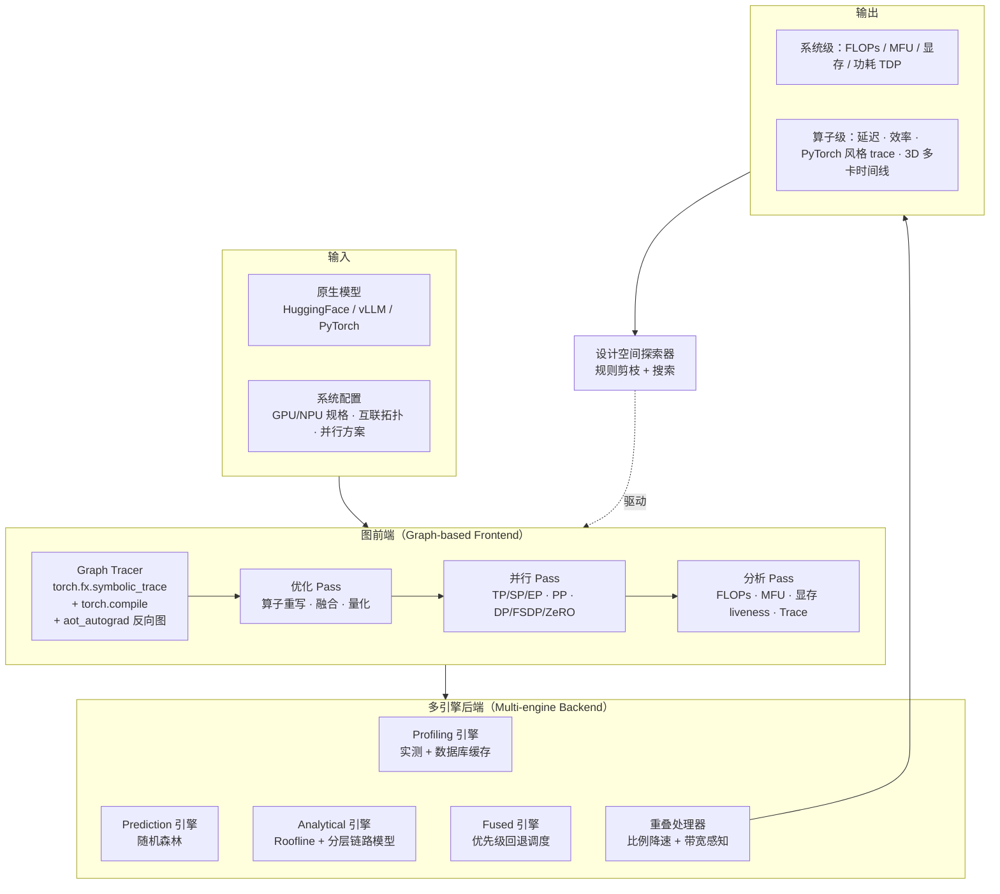
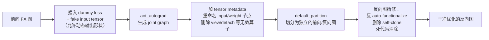

---
tags:
- 论文分析
- llm-training
- llm-inference
- simulation
- performance-modeling
- bytedance
arxiv: 2605.17164
authors: Mengtian Yang, Zhekun Zhang, Mingheng Wu, Jianwen Yan, Hanshi Sun, Li-wen Chang
created: 2026-10-12
rating: ⭐⭐⭐⭐
---

# Charon: A Unified and Fine-Grained Simulator for Large-Scale LLM Training and Inference

## 一、论文概览

| 属性 | 内容 |
|------|------|
| **标题** | Charon: A Unified and Fine-Grained Simulator for Large-Scale LLM Training and Inference |
| **机构** | ByteDance Seed（字节跳动 Seed）+ University of Texas at Austin |
| **作者** | Mengtian Yang, Zhekun Zhang, Mingheng Wu, Jianwen Yan, Hanshi Sun, Li-wen Chang（通讯：mtyang@bytedance.com / liwen.chang@bytedance.com） |
| **发表** | **Accepted by MLSys 2026** |
| **arXiv** | [2605.17164](https://arxiv.org/abs/2605.17164)（v1: 2026-05-16 / v2: 2026-05-19） |
| **分类** | cs.DC（主）+ cs.AI + cs.LG + cs.PL |
| **关键词** | LLM 性能仿真、算子级建模、混合多引擎后端、设计空间探索、通信-计算重叠 |
| **开源** | ❌ 论文未提供公开仓库（Profiling 引擎依赖其内部 GPU 集群） |
| **评分** | ⭐⭐⭐⭐ — 工程设计成熟度极高，学术新颖性中等 |

### 一句话总结

Charon 把 **LLM 性能仿真重新定义为一个"编译器式变换流程"**：直接吃原生 PyTorch/HuggingFace/vLLM 模型 → 建 FX 计算图 → 用一连串 pass 注入并行策略与优化 → 由 profiling / prediction / analytical 三种可互换引擎做算子级代价估计 → 输出端到端时间、显存、MFU 和 PyTorch Profiler 风格的 trace，并在同一框架内完成自动配置搜索。整体误差 **< 5.35%**，万卡级训练任务 **< 3.74%**，相比真实集群 profiling 声称获得 **>30,000× 的成本降低**。

---

## 二、研究背景与动机

### 2.1 规模带来的调优困境

论文开篇给出的量级很有说服力：训练一个 LLaMA-3 405B 级别的模型，需要在 16,000 张 H100 上消耗 **3000 万 GPU 小时**以上。在这个规模下，并行策略、网络拓扑、模型结构三者的协调一旦出错，代价是"数天的算力浪费"或"不可接受的 serving 延迟"。

### 2.2 设计空间爆炸：为什么 profiling 循环走不通

论文用 Figure 2(c) 刻画了传统调优闭环 **"profile → analyze → tune"** 的根本问题：

| 环节 | 现实 |
|------|------|
| 单点评估 | 需要冷启动 + 多次 warm-up 的重复运行，**数百 GPU 小时/配置** |
| 搜索空间 | 仅限制在"GPU 型号 × 并行策略"维度就有**数千种配置** |
| 总成本 | 即使把每种并行类型的候选数压到 4 个，探索成本也**逼近 $10^6$ GPU 小时** |

$$\text{总成本} \approx N_{\text{配置}} \times C_{\text{单点评估}} \approx 10^{6} \ \text{GPU 小时}$$

这就是"what-if 假设"无法被验证的根本原因——**验证一个假设的边际成本太高，导致工程师只能依赖经验直觉**。

### 2.3 现有仿真器的三类结构性缺陷

论文在 Related Work 与 Table 1 中给出了相当清晰的批评框架：

**(1) 训练/推理分裂。** 多数仿真器只能做一侧——SimAI/Lumos/Echo/dPRO 面向训练，Vidur/LLMServingSim 面向推理。工程师被迫维护两套互不兼容的工具链，而现实中推理部署的决策往往依赖训练侧的知识（反之亦然）。

**(2) 可用性开销过高。** 模型必须"在仿真器里重新搭一遍"（ASTRA-sim / SimAI / Vidur），或者必须先做离线预处理生成 trace（Lumos / Echo）。这意味着任何模型结构改动都要在仿真器侧同步改一遍——**仿真器成了模型演进的瓶颈**。

**(3) 粒度与灵活性的二选一。** 要么缺算子级粒度（ASTRA-sim / SimAI 的通信建模停留在 layer 级），要么缺改图能力（Echo / Vidur 无法通过改算子图来模拟编译优化）。前者导致重叠（overlap）建模不准，后者导致无法评估"如果把这两个算子融合会怎样"。

### Table 1：能力矩阵（原表重构）

| 能力 | Astra-sim | SimAI | Lumos | Echo | Vidur | LLMServingSim | **Charon** |
|------|:---:|:---:|:---:|:---:|:---:|:---:|:---:|
| 训练 | ✓ | ✓ | ✓ | ✓ | ✗ | ✗ | **✓** |
| 推理 | ✓ | ✗ | ✗ | ✗ | ✓ | ✓ | **✓** |
| 设计空间搜索 | ✗ | ✗ | ✗ | ✗ | ✓ | ✗ | **✓** |
| Trace 生成 | ✗ | ✗ | ✓ | ✗ | ✓ | ✗ | **✓**（含 3D Timeline） |
| 算子融合/重排等优化建模 | ✗ | ✗ | ✗ | ✓ | ✗ | ✗ | **✓** |
| 重叠降速建模 | N/A | 比例 | N/A | 预测 | N/A | N/A | **比例 + 带宽感知** |
| 计算建模 | 解析 | Profile/解析 | Profile/自研 | Profile | Profile | Profile/解析 | **解析/Profile/预测** |
| 通信建模 | 解析 | 解析 | 自研 | 解析/预测 | Profile | 解析 | **解析/Profile/预测** |
| 并行支持 | TP/DP/PP | +EP | TP/PP/DP | TP/PP/DP | TP/PP | TP/PP | **TP/PP/DP/EP/SP/ZeRO/DualPipe** |
| 输入形式 | 手工构造 | Mock 模型 | Profile Trace | Mock Trace | Mock 模型 | 手工构造 | **原生 HF/PyTorch/vLLM 模型** |

> **读法**：Table 1 中最有分量的一行是最后一行。其他所有仿真器的输入都是"仿真器自己的方言"，Charon 是唯一一个直接吃原生模型的。这一行决定了运维成本，而运维成本决定了工具能否真正进入日常流程。

---

## 三、核心贡献

论文自陈的四个设计支柱，本质上是把"编译器 IR 思想"搬到性能仿真领域：

| # | 贡献 | 对应问题 |
|---|------|---------|
| ① | **原生模型接口** — 直接接受 HF / vLLM / 自定义 PyTorch 模型，免手工构造与预处理 | 消除可用性开销（§2.3-2） |
| ② | **模块化 pass 设计** — 分析 pass 与优化 pass 即插即用，新增并行策略/优化无需重构核心 | 消除灵活性缺陷（§2.3-3） |
| ③ | **多粒度分析** — 同时产出系统级指标与 PyTorch 风格算子级 trace | 消除粒度缺陷（§2.3-3） |
| ④ | **混合多引擎后端** — 解析 / Profile / 预测三类引擎自由组合，速度-精度可调 | 在精度与成本间取得可配置平衡 |

**核心洞察（论文原话）**：

> "treat LLM simulation as a **compiler-style transformation process**, where each stage incrementally refines the model, schedule, and system representation to balance speed, accuracy, and scalability."

这个类比的关键在于：**仿真的本质不是"跑一遍"，而是"对同一份程序表示做逐层降低（lowering）"** ——原始 PyTorch 模型是高层 IR，注入并行策略后是调度 IR，最终映射到硬件代价模型。既然是 IR 变换，那么"新增一种并行策略"就等价于"新增一个 pass"，而不是"改仿真器内核"。

---

## 四、总体架构



三组件职责：

1. **图前端** — 把输入变成计算图，施加一连串编译器式 pass（trace 算子 → 注入并行 → 调度执行 → 分析结果）
2. **多引擎后端** — 对**单个算子**做代价模拟，可选 Profile / 解析 / 预测；内置重叠处理器估计重叠部分的降速
3. **设计空间探索器** — 在配置空间内搜索，带"次优配置剪枝"

---

## 五、图前端（Graph-based Frontend）

### 5.1 从原生模型到 FX 计算图

```
原生模型 (HF / vLLM / 自定义 PyTorch)
    │
    ├─ torch.fx.symbolic_trace      ← 捕获算子级结构
    │
    └─ torch.compile 编译管线        ← 优化 + 降低为统一前向图
```

**一个关键的性能优化**：现代 LLM 由大量**重复的 Transformer block**组成，因此 Charon **只 trace 并仿真单个 decoder block**。这带来数量级的加速，同时保持结构与数值保真度。

但"只仿一个 block"有两个明确的失效条件，论文都给了处理方案：

| 失效条件 | Charon 的处理 |
|---------|--------------|
| 非对称架构 / 需要 PP | 按模型定义把**不同层 trace 成独立的 FX 图**，显式按 rank 调度，保证所有 PP rank 与 stage 间依赖被建模 |
| 分离式（disaggregated）serving | 把 prefill 与 decode **分别 trace 成独立计算图**，支持异构执行（不同阶段映射到不同硬件集群） |

### 5.2 反向图的自动生成 —— 这是工程上最硬的一块

训练仿真必须要有反向图。Charon 用 `torch._function.aot_autograd` 自动生成，流程值得细看：



**为什么这里每一步都不能省**：
- `view` / `detach` 不改 tensor 的 shape 或 dtype，对性能仿真无意义 → 必须删除，否则算子计数与 trace 被噪声污染
- auto-functionalization 会把原地操作（如 `add_`）拆成函数式形式，反向图里会残留大量 wrapper → 必须反解
- `self-clone` 是 autograd 为了安全插入的冗余拷贝 → 会虚增显存估计，必须清除

论文特别提到"删除不改变 shape/dtype 的算子"和"删除 self-clone" —— 这两条直接对应**显存估计的准确性**，而显存估计错了会导致 OOM 或次优配置（§5.5 展开）。

### 5.3 编译器式 pass：优化与并行都是"改图"

这是 Charon 架构上最优雅的部分。所有优化与并行都抽象成**对计算图的操作**：

```
加入/移除 pass  ⇔  开启/关闭某个优化
不同 pass 自由组合  ⇔  联合优化
```

**算子级优化（重写与融合）** 用 **match-and-replace** 框架实现：

```
遍历计算图 → 匹配目标节点模式 → 修改节点类型与属性
```

这是经典的编译器模式匹配（类似 LLVM 的 DAG combine / peephole）。**可扩展性体现在**：新增一条优化规则 = 定义一个 match pattern + 对应 transformation，无需碰核心代码。

**量化**支持两条路径：
- 加一个量化 pass，改变节点精度
- 直接 trace 量化后的模型

论文支持 **FP32 / BF16 / FP16 / FP8 / INT8**，通过维护**精度特定的算子 profile** 或解析估计来建模。精度同时影响三个量：计算效率、显存占用、通信量——Charon 对这三者分别做 precision-aware 建模（kernel 延迟缩放、带宽缩放、activation/parameter/temporary buffer 的精度感知占用）。

### 5.4 并行策略 pass 的三类实现

| 并行类型 | 实现机制 | 插入的通信算子 |
|---------|---------|--------------|
| **分片类**（TP / SP / EP） | trace 图 → 调整被分片算子的 tensor shape → 在每个分片算子前后**按策略插入集合通信** | `all_reduce` / `all_gather` / `reduce_scatter` |
| **PP** | schedule pattern generator 构造 stage 间依赖，插入 `send`/`recv` | 支持经典 **1F1B** 与 **DualPipe**（通信-计算重叠）两种调度 |
| **DP** | 显式插入梯度同步通信算子 | 支持 **PyTorch DDP / FSDP / ZeRO**；FSDP/ZeRO 额外建模参数与优化器状态分片、优化器状态同步、**prefetch 分析** |

论文对 PP 有一句关键说明：生成的依赖图与通信事件**被记录下来供后续时间线分析与可视化**。这就是它能输出 "3D 多卡时间线" 的来源——依赖图是一等公民，可以重放、可视化、也可以在 DSE 里被反复查询。

### 5.5 多粒度分析：从 MFU 到 trace

分析器统一用**图处理**，同时支持两类指标：

| 类型 | 例子 | 处理方式 |
|------|------|---------|
| **依赖无关** | MFU | 直接在计算图上算 per-node 指标，图遍历聚合为系统级 |
| **依赖敏感** | 时间线 trace、block 延迟、E2E 延迟 | 向后端取每个算子的 start/end time → 由 **operator scheduler** 考虑算子间依赖（含 pipeline stage）→ 生成精确执行时间线 |

论文强调了一个容易被忽略的细节：**优化前后都要能分析**。例如 FLOPs 分析必须在**算子重计算（recomputation）之前**做，才能拿到准确的模型级计算成本（重计算会虚增 FLOPs 计数）。因为优化与分析都作用在同一张计算图上，Charon **天然支持二者在同一仿真流程中交错**。

### 5.6 显存建模：论文真正的技术差异化

论文对显存建模的论述是全文最有信息量的段落之一，值得完整展开。大规模训练的峰值显存来自四部分：

$$\text{Peak} = \underbrace{M_{\text{opt}}}_{\text{优化器状态}} + \underbrace{M_{\text{W+G}}}_{\text{权重+梯度}} + \underbrace{M_{\text{act}}}_{\text{激活}} + \underbrace{M_{\text{tmp}}}_{\text{临时缓冲}}$$

**层级（layer-level）仿真器的局限**：只能基于**静态张量大小**估计前两项（优化器状态、权重/梯度），后两项（激活 + 临时缓冲）根本估不了。

**Charon 的做法**：利用**反向计算图**做 **liveness 遍历**——

```
反向计算图 → 逐个中间 tensor 判定：何时分配 / 何时使用 / 何时释放
          → 复现真实的 GPU 显存行为：临时 tensor 复用 + 释放时机
          → 直接决定峰值显存占用
```

**为什么这很重要**：峰值显存恰恰出现在**反向传播过程中**。因此要评估 ZeRO / FSDP / 选择性激活检查点（activation checkpointing）这类"显存关键配置"，没有算子级 liveness 建模就是盲猜。论文明确点出这是"非图基仿真器无法捕捉"的能力。

---

## 六、多引擎后端（Multi-engine Driven Backend）

后端负责**单个算子**的代价。四类引擎：

| 引擎 | 原理 | 精度 | 速度 | 适用 |
|------|------|------|------|------|
| **Profiling** | 在目标硬件上真跑 + 运行时 profiling | 最高 | 最慢 | 常见算子/形状有缓存 |
| **Prediction** | 每类算子一个**随机森林**，输入=算子类型 + 输入 tensor shape | 高（未见形状也好） | 快 | profiling 数据库未覆盖的形状 |
| **Analytical** | Roofline（计算）/ 分层链路模型（通信） | 简单算子尚可，复杂算子差 | 最快 | 无 profile 数据的新算子 |
| **Fused** | 优先级回退调度，混用以上三者 | 自适应 | 自适应 | 异构负载 |

### 6.1 Profiling 引擎：数据库是核心

```
仿真请求 → 查询 profiling 数据库
            ├─ 命中 (operator, shape) → 直接复用缓存延迟
            └─ 未命中 → 自动生成 profiling 任务 → 派发到内部 GPU 集群 → 记录延迟
```

论文坦承"从零 profiling 每个算子实例成本过高"，因此**数据库缓存是关键设计**。这个设计也暴露了工程现实：**Charon 不是一个能独立部署的开源工具**——它需要一条内部 GPU 集群的 profiling 流水线来喂养。这是复现与迁移的最大障碍（见 §12）。

### 6.2 Prediction 引擎：为什么是随机森林

```
输入：算子类型 + 输入 tensor shape
输出：算子延迟
模型：每类算子一个紧凑的随机森林（在 profiling 数据库上训练）
```

**为什么不用神经网络？** 论文没直说，但从设计约束可以推断：
- 需要**极低推理开销**（每次仿真要调用几十万次）
- 需要**在小样本上稳定**（每个算子类型的 profile 数据量有限）
- 随机森林天然输出特征重要度，便于诊断

**这一条是全文最重要的工程结论之一**，消融实验（§9.4）给了它决定性证据。

### 6.3 Analytical 引擎

**(a) 计算算子 —— Roofline 模型**

$$T_{\text{compute}} = \max\left(\frac{\text{FLOPs}}{\text{Peak FLOPs}_{\text{hw}}},\ \frac{\text{Bytes}}{\text{Peak BW}_{\text{hw}}}\right)$$

即：算出计算时间和访存时间，取较长者为最终耗时。硬件峰值与带宽按仿真硬件预配置，算子的 FLOPs / 访存量按输入 shape **即时计算**（on-the-fly）。

**(b) 通信算子 —— 分层链路中心（hierarchical link-centric）模型**

这是设计上比 Roofline 更讲究的一部分。**核心决策：不依赖理论规格，而用 profiling 标定出的每跳延迟（per-hop latency）与有效带宽（effective bandwidth）来建集群拓扑。**

```
高层的集合通信操作
    │ 分解
    ▼
物理链路级的数据传输
    │ 每条链路
    ▼
T_link = T_handshake(标定) + DataSize / BW_effective(标定)
```

支持能力：
- **算法**：Ring 与 Tree 两类集合通信
- **拓扑**：Ring / Switch / Mesh
- **拥塞**：按带宽共享与拓扑约束评估 congestion

**为什么"链路中心"而非"理论规格"是好设计**：NCCL 的实际有效带宽与理论峰值差得很远（NVLink 标称 900 GB/s 实测常在 60-70%），且随消息大小、通信算法、拓扑层级变化。用标定值而非规格值，是"解析模型能达到工程级精度"的前提。这也解释了为什么 Charon 的通信误差能控制在个位数百分比（见 §9.2 的 All-Gather/Reduce-Scatter 数据）。

### 6.4 Fused 引擎：优先级回退

```
每个引擎维护"支持的算子注册表"
    │
    ▼
Fused 引擎为每个算子动态选择：最高优先级的可用后端
    │ 不可用则逐级回退
    ▼
profiling → prediction → analytical
```

这保证了**异构负载的鲁棒覆盖**：老算子用 profiling（准），新算子有 prediction（较准），全新算子落到 analytical（可用）。**这是"速度-精度"从全局常量变成逐算子可调参数的关键机制。**

---

## 七、算子重叠建模（Operator Overlap）

现代训练/推理框架大量使用重叠（DualPipe、ZeRO 的 prefetch、TP 通信与计算重叠）。仿真要得到细粒度准确的 trace，必须处理重叠带来的降速。Charon 提供两个层次的模型：

### 7.1 粗粒度：比例降速模型（ratio-based slowdown）

$$\Delta T_{\text{overlap}} = f_{\text{slowdown}} \times T_{\text{overlapped\_portion}}$$

- 降速因子 $f$ 由**目标硬件集群的 profiling 数据工程化标定**得到
- **计算-通信重叠**：计算与通信各用**不同**的降速因子（两者被对方拖慢的程度不同）
- **通信-通信重叠**：两个通信算子**共享同一个**降速因子
- **关键约束**：降速因子**只作用于真正重叠的那部分**，而非整个算子

> 这个"只作用于重叠部分"的约束很重要——它避免了把所有重叠场景都按最悲观假设处理，从而保留了 trace 的时间线形状。

### 7.2 细粒度：带宽感知模型（仅用于通信-通信重叠，且仅在 analytical 引擎下）

```
对重叠算子的每一段
    │
    ├─ 检查每个互联层级的链路拥塞
    │
    └─ 按有效带宽竞争比 (competition ratio) 计算降速
        → 模拟底层网络的分组级拥塞控制
```

效果（论文 Figure 6）：
- (a) 原始通信操作时间线
- (b) 拥塞感知仿真后的时间线

相比比例模型，带宽感知模型能捕捉"两条通信流共享链路时，谁挤占谁"的不对称性——这是 All-to-All（EP）与 All-Gather/Reduce-Scatter（TP/ZeRO）互相干扰时最典型的场景。

---

## 八、设计空间探索（DSE）

Charon 把 DSE 内置，目的是**消除"分析仿真结果"所需的人工工程**。

```
输入：目标模型 + 任务 + 设计空间定义（GPU 数量 × 并行大小 × ...）
    │
    ├─ 规则剪枝：用户预定义"已知低效场景"，直接跳过对应子空间
    │
    └─ 搜索 → 产出最优配置
```

**优点**：剪枝规则来自工程经验，可以免仿真直接砍掉大片无用空间，这是实用主义的好设计。

**局限**（见 §12）：论文**没有给出任何搜索算法**——没有贝叶斯优化、没有代价模型引导的控制器、没有并行搜索策略的描述。相比 [[Knowledge/论文分析/推理系统/APEX 技术分析|APEX]]（动态感知并行策略搜索）、[[Knowledge/论文分析/推理系统/AIConfigurator 深度技术分析|AIConfigurator]]、FlexFlow 的 SOAP 搜索空间、Alpa 的整数规划，Charon 的 DSE 更像"暴力枚举 + 规则剪枝"。它的竞争力来自**单点仿真足够快**（§10.2 中一整套 Pareto 前沿在 2 分钟内跑完），而不是搜索算法本身。

---

## 九、实验评估

### 9.1 实验设置

| 维度 | 内容 |
|------|------|
| **模型** | Qwen3-8B（dense）、LLaMA3-8B（dense）、Qwen3-30B-A3B（MoE） |
| **训练基线** | Astra-SIM 2.0、SimAI（框架：Megatron、VeOmni） |
| **推理基线** | Vidur（框架：vLLM） |
| **公平性处理** | 所有基线仿真器被**修 bug + 适配 Qwen3/Llama3 新模型 + 按 profiling 结果重新标定** |
| **GPU** | 训练：H800 / A100（Hopper / Ampere）；推理：H20 / L20（Hopper / Ada Lovelace） |

> **方法论亮点**：论文明确写出"为基线仿真器修 bug 并重新标定"。这类工作在多数论文里被省略，但它是"跨仿真器比较"有意义的前提。Charon 的比较因此比同类论文可信。

### 9.2 端到端精度

| 场景 | Charon 误差 |
|------|-----------|
| 整体（小规模 + 大规模集群） | **< 5.35%**（最大观测值） |
| 不同 GPU 型号 | **< 4.98%** |
| 大规模训练（近万卡 + DP/PP/EP/SP/TP 全组合） | **< 3.74%** |
| 相比集群 profiling 的成本 | **> 30,000× 降低** |

**为什么 Charon 比基线准？** 论文给了三条机制性解释：

| 对比 | 基线问题 | Charon 优势 |
|------|---------|-----------|
| vs **Astra-SIM** | 纯解析建模，无算子级精度 | 图基算子级仿真，逐算子准确 |
| vs **SimAI** | 计算用 profiling（准），但**通信基于 Astra-SIM 1.0 的 layer 级信息** | 通信也到算子级 → **重叠处理准确**（这是 SimAI 失准的主因） |
| vs **Vidur** | TTFT 准（profile 计算+通信），但 **TPOT 不准**——其预测引擎对**小算子**精度不足 | prediction 引擎对 decode 小算子仍保持精度 |

> **注意最后一条**：Vidur 在 TPOT 上的失准原因（小算子）恰好是 Charon 的弱项所在（§9.3 会看到 decode 阶段误差很大）。Charon 相对 Vidur 的优势是"更小"，而非"小到可以忽略"。

### 9.3 时间拆解（Table 2）—— 我做的误差核算

论文给出 Qwen3-8B 的算子级 breakdown。原始表格只列 Prof/Sim 两列，**下表补上了相对误差**（这一列论文没给，但它是判断细粒度精度最直接的指标）：

**Table 2(a) 训练，TP8，NVIDIA Ampere，单位 μs**

| 算子 | Prof(F) | Sim(F) | 误差(F) | Prof(B) | Sim(B) | 误差(B) |
|------|--------:|-------:|--------:|--------:|-------:|--------:|
| Attention | 1842 | 1770 | **−3.91%** | 30275 | 30329 | +0.18% |
| Feed-Forward | 6589 | 6490 | −1.50% | 40280 | 38430 | **−4.59%** |
| Others | 3842 | 3788 | −1.41% | 8743 | 8658 | −0.97% |
| All-Gather | 13180 | 12980 | −1.52% | 13130 | 12980 | −1.14% |
| Reduce-Scatter | 13876 | 12980 | **−6.46%** | 14500 | 12980 | **−10.48%** |

**Table 2(b) 推理，TP1，NVIDIA Hopper，单位 μs**

| 算子 | Prof(P) | Sim(P) | 误差(P) | Prof(D) | Sim(D) | 误差(D) |
|------|--------:|-------:|--------:|--------:|-------:|--------:|
| Attention | 3923 | 3906 | **−0.43%** | 58.206 | 72.1 | **+23.9%** |
| Feed-Forward | 9232 | 9195 | −0.40% | 93.47 | 109 | **+16.6%** |
| Others | 141 | 142 | +0.71% | 6.84 | 12 | **+75.4%** |

**从这张表能读出三件论文没有明说的事**：

1. **Prefill 极准（<1%），decode 很差（17%–75%）**。论文正文只写"demonstrate high accuracy at operator-level granularity"，但 decode 阶段的误差是**单向系统性高估**（全部 Sim > Prof）。机制上说得通：prediction 引擎的随机森林在小 tensor shape 区域外推困难，且 decode 阶段 kernel 启动开销（~5-10 μs 量级）占比极高，模型难以捕捉。**幸运的是 decode 单步绝对延迟很小（6.84–93 μs），对 E2E 的贡献被 prefill 与 batch 摊薄**，所以 E2E 误差仍能保持个位数。

2. **通信算子的 Sim 值完全恒定（12980）**。All-Gather 与 Reduce-Scatter 在 F/B 四个格子里的仿真值都是 12980。这**不是 bug**——TP 场景下前向 all-gather 与反向 reduce-scatter 搬运的数据量相同，解析模型对等大小消息给出相同延迟是正确的。但它同时说明：**解析通信模型是完全确定性的**，对拥塞、抖动、消息大小微小差异零敏感。这正好解释了 §9.5 论文自陈的"残余误差来自真实集群的随机性"。

3. **Reduce-Scatter 是训练侧最大的误差来源（−6.5% / −10.5%）**。反向的 reduce-scatter 被低估 10.5%，说明解析链路模型在反向通信（可能与梯度计算重叠）的降速建模上偏乐观。

### 9.4 显存预测精度

设置：Qwen3-30B-A3B（MoE）训练，8 GPU，FSDP=8，batch=2，seqlen=8192。MoE 的动态路由带来复杂显存访问模式，是显存建模的硬骨头。

| 指标 | 误差 |
|------|-----:|
| 最大**已分配**显存（max allocated） | **+0.39%** |
| 最大**已预留**显存（max reserved） | **+0.29%** |
| 总显存占用（total footprint） | **−0.03%** |

论文说明精度的来源：**纳入标定的集合通信缓冲开销 + 动态碎片化效应（dynamic fragmentation）**。

> 这三个数字是全文最亮眼的实验结果。**亚 0.5% 的显存误差**意味着 Charon 可以直接用于"这个配置会不会 OOM"的判定——而这恰恰是 §5.6 的 liveness 建模要解决的问题。考虑到实验对象是 MoE + FSDP（最复杂的组合），这个结果有说服力。

### 9.5 后端消融：随机森林 vs Roofline

针对**未见过的 tensor shape**，对比解析引擎（Roofline）与预测引擎：

| 算子 | 解析引擎 MAE | 预测引擎 MAE |
|------|------------:|------------:|
| Linear | 尚可 | **1.44%** |
| RMSNorm | 尚可 | **1.12%** |
| **FlashAttention-3** | **31.84%** | **2.22%** |

> **这是全文技术含量最高的一个数据点。** Roofline 在 Linear / RMSNorm 上"尚可"，但在 FlashAttention-3 上 MAE 高达 **31.84%** —— 因为 FA3 是高度融合、计算与访存深度交错、含 warp specialization 的复杂 kernel，**纯 Roofline 的 max(compute, memory) 二分法在数学上就无法描述它**。
>
> 而随机森林在 FA3 上只有 **2.22%**。**结论**：在算子融合越来越激进的今天（FA3 之后还有 FA4、FlashInfer、各类 fused MoE kernel），**解析模型的天花板已经到顶**，ML 驱动的算子级预测从"可选优化"变成"结构必需"。
>
> **这也是 Charon 相对 GenZ（纯 Roofline 解析建模，见 [[Knowledge/论文分析/推理系统/GenZ 深度技术分析]]）的架构性优势**：GenZ 用 Roofline 换取了极致的轻量，Charon 用随机森林换取了融合 kernel 时代的精度。

### 9.6 跨 GPU 与集群规模

论文用多组内部 profiling 实验（训练 + 推理性能调试）做对照，比较**每步归一化 E2E 延迟**：

- 覆盖 **H800 / A100**（训练）与 **H20 / L20**（推理），整体误差 < 4.98%
- 训练扩展到 **近万卡** + DP/PP/EP/SP/TP **全并行组合**，误差 < 3.74%
- 小规模与大规模集群的**最大整体误差 < 5.35%**

**论文对残余误差的诚实解释**：真实执行 trace 存在固有运行时波动——网络通信抖动、动态拥塞、数据相关的 kernel 执行随机性。Charon **当前不确定性地建模这些微观随机变化**，因此存在偏差。但论文认为这些差距不影响仿真器提供高可靠性能与可扩展性分析的能力。

> 这个解释与 §9.3 的观察（解析模型完全确定性，Sim 值恒定）完全吻合。

---

## 十、案例研究

### 10.1 动态序列并行策略（Dynamic Sequence Parallelism）

**背景**：Sequence Parallelism（SP）常用于优化 LLM serving 的 **prefill 延迟**，把 attention 计算分布到多个 rank。广受采用的 **zigzag attention** 把序列维度切成 $2 \times SP$ 块，每个 rank 以 zigzag 模式领两块以均衡负载（LLaMA-3 等大规模模型已采用）。

**zigzag 的失效条件（论文的关键观察）**：
- 对**短序列**，zigzag **过度切分**输入
- 引入的 all-gather 通信开销**不成比例地增大**
- 通信开销**超过**了计算均衡带来的收益

**Charon 的解法 —— dynamic SP**：

```
传统 zigzag：batch 内所有请求使用同一套 SP/zigzag 配置（one-size-fits-all）
Dynamic SP ：batch 内每个请求分配不同的 SP 配置
              ├─ 长序列请求 → 保持 zigzag 式 rank 均衡
              └─ 短序列请求 → 减少过度切分，避免多余 all-gather
```

论文用 Charon 分析"不同序列长度分布下计算分布 vs 通信开销的权衡"：同时建模 **kernel 执行**与 **NCCL 通信** → 预测 per-rank 延迟 → 生成使 prefill 阶段 attention 延迟最小的**请求级最优 SP 策略**。

Figure 12 的例子：request 1 采用 SP4，request 2 采用 SP2 + zigzag。

| 实验设置 | 结果 |
|---------|------|
| LLaMA-3 70B，8× NVIDIA Ada Lovelace 推理 GPU | attention block 延迟**平均降低 15%** |

**收益来源分解**：
1. 短序列请求**禁用 zigzag 切分** → 避免不必要的 all-gather 成本
2. 请求间**混用不同 SP 计划** → 进一步均衡计算与通信

**论文的前瞻判断**：在通信延迟更高的硬件（如 PCIe 互联）上，收益会**更大**——因为降低通信开销的边际价值更高。

> **评注**：这是一个"用仿真器指导出真实系统改进"的漂亮案例，但论文**没有给出生成最优请求级 SP 策略的算法**——是贪心？是整数规划？是枚举？搜索空间多大？这部分只有结果没有方法，可复现性不足。

### 10.2 推理配置的多目标优化

**问题的形式化**：LLM 推理是多目标优化。

| 指标 | 含义 | 约束/目标 |
|------|------|----------|
| **TTFT** | Time To First Token | 用户侧 SLO |
| **TPOT** | Time Per Output Token | 用户侧 SLO |
| **TPS/user** | 用户侧吞吐（由 TTFT + TPOT 决定） | 约束 |
| **TPS/GPU** | 系统吞吐，决定每 token 成本 | **最大化目标** |

**决策变量**：调度算法、TP/PP 大小、prefill chunk size、prefill batch size、decode batch size……

$$\max\ \text{TPS/GPU}\quad \text{s.t.}\quad \text{TTFT} \le \text{SLO}_{\text{TTFT}},\ \text{TPOT} \le \text{SLO}_{\text{TPOT}}$$

论文指出：这些参数**相互依赖极度复杂，解析求解往往不可行**，因此业界主流是"大量经验性 benchmark"——成本高、耗时长，且需要**对参数交互有深刻专业知识**（大多数用户不具备）。

**Charon 的贡献**：把成本-延迟权衡空间的探索成本降到**约 2 分钟内完成整套分析**，从而快速定位满足 TPS/user 约束的最优部署参数。

**LLaMA-3 70B on NVIDIA Hopper 推理 GPU 的结果（Figure 13）**：

| 观察 | 数据 |
|------|------|
| Charon 找到的最优点（红点）vs 次优点（蓝点） | 同等用户侧性能下，TPS/GPU **显著提升** |
| 最优前沿上的权衡 | 放宽用户侧 TPS 约束，系统吞吐最多可提升 **7×**（直接降低单位成本） |
| 生产环境验证 | 固定输出长度服务 + **严格 100ms E2E 延迟 SLO** 下，Charon 找到的配置**大幅优于人工调优的基线** |

**为什么能这么快？** 三个机制：
1. 使用**预 profile 的 kernel 延迟**（不在搜索循环里跑硬件）
2. **多进程并行仿真**
3. 深度集成内部推理框架 + 标准 HF Transformers：**自动从 HF config 解析模型架构**；从内部框架提取 **PyTorch FX 图表示与对应 kernel 实现**

论文称这让"使用 Charon 的额外工作量接近零"（minimizes the effort required to use Charon to nearly zero）。

---

## 十一、关键洞察

### 洞察 1：仿真的正确抽象是"编译器 IR"，不是"跑一遍模型"

传统仿真器把"模型"翻译成自己的内部表示 → 每加一种模型/策略就要改内核。Charon 把模型表示成 FX 图，把策略表示成 pass。**一旦承认"策略即改图"，扩展性问题就从架构问题降级为规则问题。** 这是 Charon 能同时支持 TP/PP/DP/EP/SP/ZeRO/DualPipe 六类并行，还能量化/算子融合/重排/重计算的架构原因。

### 洞察 2：单点仿真的速度 > 搜索算法的智能

Charon 的 DSE 只有"枚举 + 规则剪枝"，却是全文最有生产价值的部件。原因：**2 分钟跑完整个 Pareto 前沿**。当单点评估足够便宜时，搜索问题就退化成了工程问题。这与 [[Knowledge/论文分析/推理系统/APEX 技术分析|APEX]]、FlexFlow、Alpa 的路线形成鲜明对比——那些工作花大力气设计搜索算法，前提是单点评估昂贵。**Charon 用精度换来的速度，把问题从"搜索理论"挪到了"吞吐工程"。**

### 洞察 3：解析模型在融合 kernel 时代到头了

FA3 上 Roofline MAE 31.84% vs 随机森林 2.22%（§9.5）。这个对比的含义远超 Charon 本身：**只要算子融合继续加深（FA、fused MoE、fused RMSNorm+Linear），纯解析建模的误差上限就会不断恶化。** 混合引擎不是"折衷方案"，而是**必然的架构选择**。反过来说，[[Knowledge/论文分析/推理系统/GenZ 深度技术分析|GenZ]] 这类纯 Roofline 方案在未来的适用边界会收窄。

### 洞察 4：显存建模必须走图，不能用静态张量表

峰值显存出现在**反向传播中间**，且由 **activation + 临时 buffer** 主导，而非权重/优化器状态。因此：
```
静态张量大小估计  → 只能算权重/梯度/优化器状态（小头）
反向图 liveness 遍历 → 能算激活/临时 buffer 的分配-释放-复用（大头）
```
这是 Charon 显存误差能做到 **0.39% / 0.29% / −0.03%** 的原因，也是**任何层级（layer-level）仿真器在原理上无法复现**的能力。对 MoE + FSDP 这种组合，这条差异决定仿真器能否用于 OOM 判定。

### 洞察 5："通信建模用标定值而非理论规格"是解析模型工程化的分水岭

Charon 的通信模型不接受"N 卡 NVLink 带宽 = 900 GB/s"这类规格输入，而是用 profiling 标定的 **per-hop latency + effective bandwidth**。这解释了它为什么在 All-Gather / Reduce-Scatter 上能到 1.5% 级误差。**规格值是乐观上界，标定值是工程现实**——两者的差距在集合通信里常常是 2× 量级。

### 洞察 6：原生模型接口是降低"工具采纳成本"的唯一有效手段

Table 1 最后一行暗示的规律：Tool adoption ∝ 1/(迁移成本)。Vidur 要求"在仿真框架里重建模型"——这意味着每次模型结构试验都要双份工作量。Charon 直接吃 FX 图/HF config，**把仿真从"额外工作"变成"零工作"**（论文自称 nearly zero effort）。**一个仿真器的学术指标（误差）决定它能否发表，而它的迁移成本决定它能否被使用。**

---

## 十二、优点与局限

### 优点

| # | 优点 | 证据 |
|---|------|------|
| 1 | **真正的训练+推理统一**（Table 1 唯一同时覆盖两侧并支持 DSE 的工作） | 同一框架仿真训练/推理，共享前端与并行 pass |
| 2 | **原生模型接入**，消除手工建模与离线预处理 | `torch.fx.symbolic_trace` + `torch.compile` 直接吃 HF/vLLM/PyTorch |
| 3 | **显存建模精度的降维打击** | MoE+FSDP 下 0.39% / 0.29% / −0.03% |
| 4 | **算子融合时代的正确后端选择** | FA3: 解析 31.84% vs 预测 2.22% |
| 5 | **并行覆盖度最广** | TP/PP/DP/EP/SP/ZeRO/DualPipe，含 1F1B 与 DualPipe 两种调度 |
| 6 | **比较方法学严谨** | 给基线仿真器修 bug + 适配新模型 + 重新标定 |
| 7 | **生产验证而非只做 benchmark** | 100ms SLO 场景下超越人工调优基线；dynamic SP 降 15% 延迟 |
| 8 | **可配置的速度-精度权衡** | Fused 引擎的优先级回退机制 |

### 局限与质疑

| # | 局限 | 说明 |
|---|------|------|
| 1 | **无公开代码，且强依赖内部 GPU 集群** | Profiling 引擎"派发任务到我们的内部 GPU 集群"——这意味着第三方**无法复现**，也**无法在外部环境部署**。论文的核心卖点（混合多引擎）在最可复现的部分（analytical）恰恰是最弱的部分（FA3 上 31.84%）。 |
| 2 | **decode 阶段误差被 E2E 掩盖** | Table 2(b) 显示 decode 算子误差 **16.6%–75.4%**（全部高估）。论文正文只称"high accuracy at operator-level granularity"，未披露这一负向结果。对 **decode-bound 的延迟敏感场景**（长输出、小 batch、严格 TPOT SLO），这个误差会被显著放大。 |
| 3 | **解析通信模型零随机性** | §9.3 观察到 Sim 通信值恒定（12980）。论文承认未建模抖动/拥塞。在异构网络、超售网络或跨 DC 场景下，确定性模型可能高估可用带宽。 |
| 4 | **模型规模覆盖有限** | 实验只到 **Qwen3-8B / LLaMA3-8B / Qwen3-30B-A3B**。没有 405B 级 dense、没有 DeepSeek-V3 级 671B MoE。而论文的动机（30M GPU 小时、万卡）正是针对这个规模。**"近万卡"实验的模型规模未披露**——如果是在 8B 模型上跑万卡，其 EP/PP 通信模式并不能代表千亿参数的负载特征。 |
| 5 | **训练侧算子级 breakdown 只有 TP8** | Table 2(a) 只有 TP8。DP/PP/EP/SP/DualPipe 的算子级精度、以及 PP 气泡（bubble）率建模精度**均未展示**——而这正是它对标 SimAI/vTrain 的差异化能力。 |
| 6 | **DSE 算法未披露** | 只有"规则剪枝 + 搜索"。无搜索算法、无复杂度分析、无与贝叶斯/TPE/整数规划的对比。剪枝规则是人工预定义的——**这意味着 DSE 的有效性依赖专家知识，削弱了"降低专业门槛"的宣称**。 |
| 7 | **Dynamic SP 缺方法** | 15% 提升是真实结果，但"如何生成最优请求级 SP 策略"无算法描述、无搜索空间定义、无与静态 SP 的完整对比矩阵（只有 8×Ada 一个配置）。 |
| 8 | **单 block 仿真的前提未充分验证** | "只仿真一个 decoder block"依赖架构对称性。论文给了 PP/非对称架构的 fallback，但**未量化**单 block 外推在深层异构（如 sliding-window/Local-Global 混合 attention、MoE 层不均匀分布）下的误差。 |
| 9 | **"30,000× 成本降低"缺口径** | 该数字只在 Figure 1 caption 出现，未说明比较基准（是 1 次 profiling 运行 vs 1 次仿真？还是完整搜索空间？）、未说明绝对数值（GPU 小时数）、未计入 profiling 数据库的**构建成本**（那本身是集群真跑）。**成本核算不完整。** |
| 10 | **无功耗/能耗目标优化** | 输出包含 power/TDP 估计，但 DSE 的目标函数只有 TPS/GPU，未把能耗或 TCO 纳入搜索。在兆瓦级集群时代这是明显的缺口。 |
| 11 | **模型无关性未测试** | 只测了 decoder-only Transformer。dense/MoE 都覆盖了，但 Mamba/SSM 混合（GenZ 明确支持 MoE+Mamba）、多模态编码器、扩散模型均未涉及。 |

### 核心矛盾

> **Charon 最强的能力（多引擎混合、原生模型接入、万卡精度）全都建立在"能访问 ByteDance 内部 GPU 集群做 profiling"这个前提上**。论文在学术层面证明了这个架构是对的，但其中最有价值的部分——profiling 数据库和它支撑的 prediction 引擎——**恰恰是外部世界无法拥有的**。这使得论文的价值更多体现在**架构范式**（编译器式仿真 + 混合引擎）而非**可复现的方法**。

---

## 十三、与知识库既有工作的定位

把 Charon 放进本知识库既有的 LLM 仿真器图谱：

| 工作 | 定位 | 相对 Charon 的位置 |
|------|------|------------------|
| [[Knowledge/论文分析/推理系统/Vidur 深度技术分析\|Vidur]] | 推理专用，profile 计算+通信，TTFT 准/TPOT 不准 | Charon 借鉴其 profile 思路，但补上 prediction 引擎（解决小算子）+ 训练侧 |
| [[Knowledge/论文分析/推理系统/LLMServingSim 2.0 技术分析\|LLMServingSim 2.0]] | 推理仿真，报告 **0.95%** 误差 | **精度上 Charon（5.35%）不如它**，但 LLMServingSim 需 mock 模型，Charon 吃原生模型且覆盖训练 |
| [[Knowledge/论文分析/推理系统/LLM-Emu 技术分析\|LLM-Emu]] | 在线仿真，跑真实 vLLM 代码路径，<5% 中位误差 | 路线相反：LLM-Emu 在真实系统里插桩，Charon 在离线图上降低 |
| [[Knowledge/论文分析/推理系统/Frontier 技术分析\|Frontier]] | 精细化算子仿真（港中文/StepFun） | 最接近的同路线工作；差异在 Charon 的 pass 化前端与混合引擎 |
| [[Knowledge/论文分析/推理系统/GenZ 深度技术分析\|GenZ]] | 纯 Roofline 解析，唯一支持 MoE+Mamba | Charon 的消融实验（§9.5）**间接证伪了纯 Roofline 在融合 kernel 上的可行性** |
| [[Knowledge/论文分析/推理系统/APEX 技术分析\|APEX]] | 动态感知并行策略搜索 | 搜索算法比 Charon 讲究，但没有训练侧与算子级 trace |
| [[Knowledge/论文分析/推理系统/AIConfigurator 深度技术分析\|AIConfigurator]] | NVIDIA 多框架推理配置优化 | 定位与 Charon §10.2 高度重叠；AIConfigurator 更聚焦配置知识库，Charon 更聚焦仿真保真 |
| [[Knowledge/论文分析/训练系统/vTrain 训练仿真框架 深度技术分析\|vTrain]] | KAIST/Samsung 训练仿真，profiling 驱动 | 训练侧前作（2023）；Charon 的增量是图化前端 + 混合引擎 + 与推理统一 |
| [[Knowledge/论文分析/训练系统/Chakra 技术分析\|Chakra]] | 标准化 execution trace + 仿真（Meta/GT） | Charon 也在内部生成 trace，但不需要外部标准化 schema |
| [[Knowledge/论文分析/芯片建模/Roofline Model 技术分析\|Roofline Model]] | 经典解析模型 | Charon analytical 引擎的计算侧建模基础 |
| [[Knowledge/论文分析/训练系统/NeuSight GPU 性能预测 技术分析\|NeuSight]] | ML 驱动 GPU 性能预测（未见 GPU 上 <10%） | 与 Charon 的 prediction 引擎同源思路；NeuSight 跨 GPU 泛化更强，Charon 绑定已 profile 的硬件 |
| [[Knowledge/开源项目分析/SimuMax LLM分布式训练静态分析模型深度技术分析\|SimuMax]] | 分布式训练静态分析模型 | 同为"不真跑硬件"的路线，SimuMax 偏静态解析，Charon 偏图 + 多引擎 |
| [[Knowledge/开源项目分析/VenusSim LLM训练性能仿真模拟器深度技术分析\|VenusSim]] | 训练性能仿真器 | 同赛道；Charon 在显存建模（liveness）上更细 |

### 一句话定位

**Charon = Vidur 的推理精度 + vTrain 的训练覆盖 + Frontier 的算子粒度 + 编译器的可扩展前端 + 随机森林补齐解析模型的天花板。**

它没有在任何单一维度上做到最好（LLMServingSim 2.0 更准、APEX 搜索更聪明、NeuSight 泛化更好），但它是**唯一一个把训练、推理、算子级粒度、原生模型接入、DSE 全部放进一个框架的工作**。

---

## 十四、总结

Charon 是一篇**工程完成度远高于学术新颖度**的系统论文，这符合 MLSys 的取向。它的学术贡献是把"编译器 IR + pass"这个已经成熟的抽象，系统地搬到 LLM 性能仿真上，并证明这个抽象能同时解决**扩展性**（新并行/新优化 = 新 pass）、**可用性**（原生模型直接接入）、**精度**（混合引擎按算子自适应）三个之前被认为是 trade-off 的问题。

工程上最值得学习的三条：

1. **`aot_autograd` 自动生成反向图 + 一系列图清理**（去 view/detach、反 auto-functionalize、去 self-clone、死代码消除）——这是训练仿真器能"直接吃原生模型"的技术前提，也是显存估计能到亚 0.5% 误差的基础。
2. **FA3 上 Roofline 31.84% vs 随机森林 2.22%** ——一条足以改变后端选型决策线的数据点。解析模型在融合 kernel 时代的天花板已经被量化。
3. **反向图 liveness 遍历算峰值显存** ——把显存建模从"静态张量求和"升级为"分配-使用-释放时序还原"，这是 MoE+FSDP 场景下唯一可用的方法。

最需要警惕的一点：**它的核心竞争力（profiling 数据库 + prediction 引擎）不可复现**，而可复现的部分（analytical 引擎）在最难的算子上误差超过 30%。读这篇论文时，应该把它的价值定位在**架构范式的示范**，而不是**方法的直接复用**。

---

## 相关笔记

- [[Knowledge/论文分析/推理系统/Vidur 深度技术分析]]
- [[Knowledge/论文分析/推理系统/LLMServingSim 2.0 技术分析]]
- [[Knowledge/论文分析/推理系统/LLM-Emu 技术分析]]
- [[Knowledge/论文分析/推理系统/Frontier 技术分析]]
- [[Knowledge/论文分析/推理系统/GenZ 深度技术分析]]
- [[Knowledge/论文分析/推理系统/APEX 技术分析]]
- [[Knowledge/论文分析/推理系统/AIConfigurator 深度技术分析]]
- [[Knowledge/论文分析/训练系统/vTrain 训练仿真框架 深度技术分析]]
- [[Knowledge/论文分析/训练系统/Chakra 技术分析]]
- [[Knowledge/论文分析/训练系统/NeuSight GPU 性能预测 技术分析]]
- [[Knowledge/论文分析/训练系统/训练系统性能建模仿真综述]]
- [[Knowledge/论文分析/芯片建模/Roofline Model 技术分析]]
- [[Knowledge/论文分析/芯片建模/芯片性能建模与仿真深度综述]]
- [[Knowledge/论文分析/推理系统/LLM推理系统深度综述]]
- [[Knowledge/开源项目分析/VenusSim LLM训练性能仿真模拟器深度技术分析]]
- [[Knowledge/开源项目分析/SimuMax LLM分布式训练静态分析模型深度技术分析]]
