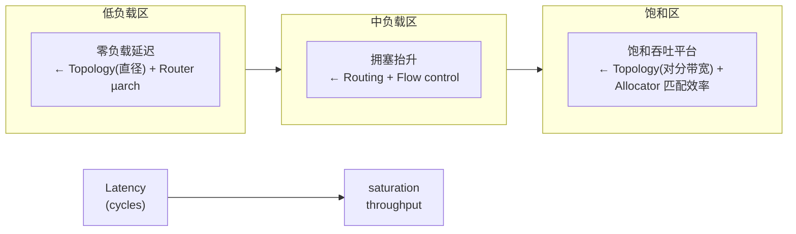
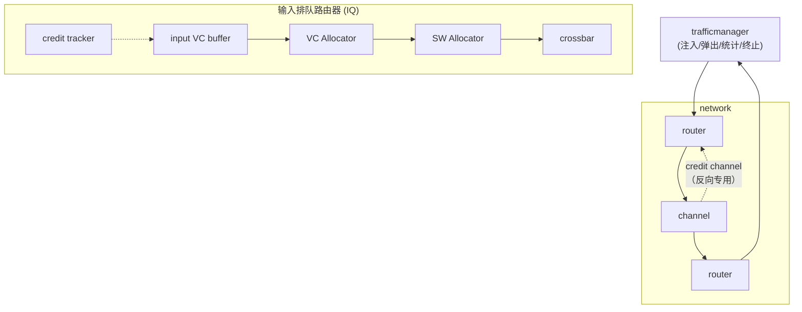
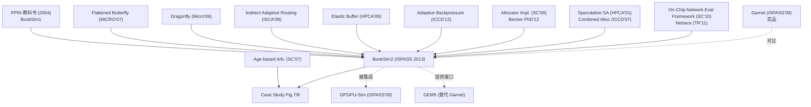

---
tags:
- 论文分析
- chip-modeling
- noc
- interconnect
- simulation
- network-simulation
source: https://github.com/booksim/booksim2
arxiv:
authors: Nan Jiang, Daniel U. Becker, George Michelogiannakis, James Balfour, Brian Towles, John Kim, William J. Dally
institutions: Stanford University, Lawrence Berkeley National Lab, Google, D.E. Shaw, KAIST, NVIDIA Research
venue: ISPASS 2013
doi: 10.1109/ISPASS.2013.6557149
created: 2026-10-16
rating: ⭐⭐⭐⭐（工具生态价值 ⭐⭐⭐⭐⭐ / 论文自身严谨性 ⭐⭐⭐）
open_source: true (https://github.com/booksim/booksim2 — BSD-3, 479★ / 236 forks, master 最后提交 2017-06-27，已休眠 9 年)
citations: 827 (Semantic Scholar)
---

# BookSim 2.0：细致且灵活的周期精确 NoC 仿真器（A Detailed and Flexible Cycle-Accurate Network-on-Chip Simulator）

> **本笔记包含我的独立复现**：我从零构建了 BookSim 2.0、跑通了论文 Fig.5 / Fig.6 / Fig.7 三组实验，并把论文自己的表格重算成相对误差。复现结果写在 [§三](#三实验评估论文原数据--我的独立复现)，审计结论写在 [§四](#四论文审计我做的增量分析)。**注意区分「论文的结论」与「我做的增量分析」。**

---

## 一、论文概览

| 属性 | 内容 |
|------|------|
| **标题** | A Detailed and Flexible Cycle-Accurate Network-on-Chip Simulator |
| **会议** | ISPASS 2013, pp. 86–96（11 页） |
| **DOI** | 10.1109/ISPASS.2013.6557149 |
| **作者** | Nan Jiang, Daniel U. Becker, George Michelogiannakis, James Balfour, Brian Towles, John Kim, William J. Dally（**7 人**） |
| **机构** | Stanford / LBNL / Google / D.E. Shaw / KAIST / NVIDIA Research |
| **引用** | **827 次**（Semantic Scholar，2026-10）——NoC 领域仿真器的最高引用之一 |
| **代码** | https://github.com/booksim/booksim2（BSD-3，479★，236 forks，25,119 行 C++） |
| **代码状态** | master 最后一次提交 **2017-06-27**（Daniel Becker），12 个分支，无 release tag |
| **前身** | booksim/booksim（BookSim 1.0，27★，2014 年后停更） |
| **配套** | BookSim 2.0 User's Guide（LaTeX 手册，`doc/manual.tex`，683 行，未正式出版） |

### 核心贡献

1. **把「互联网络仿真」变成可编程对象**：提出 topology / routing / flow control / router microarchitecture 四轴刻画框架，每条轴都做成可替换模块 + 配置参数（代码级约 120 个可配置键）。
2. **论文首个把网络仿真器结果与 RTL 路由器实现逐点对齐**——3×3 mesh、1 VC、16-flit 缓冲、可分离 input-first 分配器，最大网络延迟差 5%、最大可接受吞吐差 3%。
3. **BookSim2 的 evaluate/update 两阶段协议**：修复了 BookSim1 「流水线各阶段顺序执行、每级都直接改路由器状态」导致的非物理信息传播（最典型是推测式开关分配下，开关分配器能「看见」同一周期 VC 分配是否成功）。
4. **四种 VC+开关分配同周期方案** + 推测式路由，把路由器流水线从 4 级压到 **2 级**（论文声明 2 级是"现实可实现"的下限）。
5. **动态输入缓冲管理**（buffer sharing）与 **age-based 优先级**的副作用分析——后者给出了论文唯一的"新知识"：age-based 优先级在**非对抗性**的 uniform 流量下也会改变饱和吞吐（此前文献只研究它在对抗流量下的公平性）。

### 一句话定位

> **BookSim 是 NoC 领域的 "gem5 + Garnet" 的独立化版本，也是唯一同时被 GPGPU-Sim 和 GEM5 两个全系统仿真器当作片上网络后端的 NoC 仿真器。** 它把 Dally & Towles 教科书《Principles and Practices of Interconnection Networks》的性能图生成器，变成了可编程、可扩展、带 RTL 标定的标准工具；13 年后它仍在被引用，但引用者已经主要不是 NoC 研究者，而是**芯片间互联（chiplet / 3D 集成）**和 **LLM 加速器**设计者。

---

## 二、技术方法详解

### 2.1 四轴刻画框架：论文的分析骨架

论文把任何互联网络的性能拆成四条相互制约的轴，并给出它们各自主导的负载区间（论文 Fig.1）：

| 轴 | 决定什么 | 主导区间 |
|----|---------|---------|
| **Topology** | 对分带宽 + 网络直径 → 吞吐与延迟的硬上界 | 高负载（吞吐天花板） |
| **Routing** | 把通信映射到拓扑上，决定能否逼近拓扑上界 | 中高负载 |
| **Flow control** | 竞争时缓冲/带宽如何利用 | 中负载 |
| **Router µarch** | 路由器效率与竞争效应 | **低负载（零负载延迟）** |



**这张图是全文的方法论地基，也是它后来被大量引用的原因**——它把"该改哪一层"变成了可判断的问题。但也埋下了本文最重要的审计点：见 [§4.1](#41-口径核验20-是-hop-计数算术的必然结果不是优化的功劳)。

### 2.2 模拟器架构

**BookSim1（论文 §III）的两条设计原则**：

1. **模块层级化**：`trafficmanager`（源/目的端点）↔ `network`（routers + channels），拓扑决定怎么连。所有相邻路由器之间的通信必须走显式 `send/receive` 通道，**不能用全局变量或共享数据结构**——这是硬性约束，目的是"强迫使用者先按物理实体思考网络"。
2. **flit 级、周期级**：一个 packet = 若干 flit（流控与缓冲分配的最小单位）；所有通道与流水线宽度 = 1 flit；每周期每条通道读 1 flit、写 1 flit。**改通道宽度的方法不是改配置，而是改 packet 的 flit 数**（512-bit packet 在 64-bit 通道上是 8 flit，在 32-bit 通道上是 16 flit）。



**关键工程细节（论文一句话带过，但实际影响很大）**：

- **无限源队列**：注入节点在源端无限排队，但只有队头注入网络。目的：在**开环**仿真中越过饱和点后，延迟量仍然把源排队延迟与队头阻塞算进去。
- **credit-based 流控**：每条网络通道配一条反方向专用 credit 通道。
- **加速（speedup）三选项**：`internal_speedup`（路由器内部时钟快于通道，1.5 表示 3 个路由器周期对应 2 个通道周期，需在输出端加缓冲）、`input_speedup`（每个输入端口展开成 s 个 crossbar 输入，VC v 接到端口 i·s + (v mod s)）、`output_speedup`。**k 端口路由器在 input_speedup = k 且 k 个 VC 时，等价于输出排队路由器**。
- **atomic VC allocation**（`wait_for_tail_credit`）：VC 在该 packet 的尾 flit credit 回来之前不能被重新分配 → 每个 VC 同时只容纳一个 packet，消除 packet 间依赖。小 VC 数时普通分配吞吐更高，大 VC 数时 atomic 更好。

**Pipeline（论文 Fig.4）**：`Routing/Queuing → VC Allocation → Switch Allocation → Crossbar Traversal`，每级延迟可任意配置，**整条流水线可被配成单周期路由器**（代价是交叉开关长度不可实现）。

### 2.3 BookSim2 的五项关键升级（论文 §IV）

#### (1) evaluate/update 两阶段协议 —— 全文最本质的改动

**BookSim1 的 bug 性质**：流水线各阶段顺序执行，且每级执行后**直接改写路由器状态**。于是：

> 在推测式开关分配下，VC 分配和开关分配本应并行执行；但模拟器实际串行执行并在中间更新状态，导致**开关分配器知道 VC 分配是否成功**——真实硬件同周期拿不到这个信息。结果：模拟器把「推测失败」的路径全部绕过了。论文原话：*"unrealistically avoids cases of misspeculation"*。

**BookSim2 的修法**：
- **evaluate 阶段**（≈ 组合逻辑）：**只允许读**路由器状态，产出一组带生效时间的 state update；
- **update 阶段**（≈ 时序逻辑）：在**所有路由器的所有流水线级**都评估完之后，统一把到期的 update 写回。

这强制了干净的时钟边界，消除了"本应并行却被意外串行化"的所有情形。**这是"周期精确"这四个字真正兑现的地方**，也是纸上读起来最枯燥、工程价值最高的部分。

#### (2) 流水线优化 → 4 级压到 2 级

| 技术 | 做法 | 代价 / 陷阱 |
|------|------|-----------|
| **Look-ahead routing** | 把路由级延迟置 0（下一跳信息在上游路由器预计算） | ⚠️ **只在固定路由下成立**。自适应路由需建模拥塞信息传播延迟——上游拿到的是**过期的**网络状态；置 0 会高估自适应路由质量 |
| **推测式开关分配** | head flit 同时请求 VC 和开关；成功后并行 | 推测失败时 crossbar 时隙被浪费 → 必须让非推测请求**优先**。论文给了 **3 种机制**：① 静态高优先级 + BookSim 的 priority-aware 分配器（winner-takes-all）② [18] 的双分配器 + 结果合并（`spec_sw_allocator` 指向真实分配器）③ 悲观掩码（`spec_mask_by_reqs`），用更早可得的非推测请求屏蔽推测请求 |
| **combined VC+switch allocation** | head flit 直接参与开关分配，赢了就分配一个空闲输出 VC | 非推测请求必须优先；推测冲突同时取消开关 grant **和** VC grant，机会成本高于前两者 |

> **结果：路由级归零 + 上述任一技术 → 4 级流水线变 2 级。论文明确声明 BookSim2 的最小现实路由器延迟 = 2 周期**（单周期需要开关分配与开关穿越在同一周期串行，critical path 不可实现）。

#### (3) 分配器与优先级

- **分配器套件**（代码级比论文更全）：`max_size`（最大匹配）、`islip`、`pim`、`loa`（lonely output）、`wavefront`、`rr_wavefront`、`select`（优先级偏好版 iSLIP）、`separable_input_first`、`separable_output_first`。
- **仲裁器套件**：matrix、round-robin、weighted round-robin、tree，**全部 priority-aware** → 可组合出优先级感知的可分离分配器。
- **包优先级**：静态（按 traffic class）或动态（`priority = age | network_age | local_age | queue_length | hop_count | sequence`）。
- **优先级捐赠**（`vc_priority_donation`）：防止优先级反转——buffer 中的队头 flit 继承该 buffer 内所有 packet 的最高优先级。
- **可分离分配器的失效机制**（论文自己分析得很透）：可分离分配器把分配拆成多级仲裁，硬件延迟低但**匹配质量差**——同一级内多个仲裁器会独立选中同一个输出端口，结果只有一个 grant 生效，其余端口空转。

#### (4) 动态输入缓冲管理

- **动机**：输入缓冲是 NoC 路由器的**面积与功耗大头**（论文引 [24][25]）。静态给每个 VC 分配固定槽位时，为保证 credit 往返延迟而预留的缓冲在重载下仍大量空闲。
- **BookSim2 实现**：共享缓冲池 + 混合方案（部分共享）。工程上**通过限制输出端口的 credit 可得性来实现**——把信用跟踪机制模块化，允许静态或动态地限定每个 VC 能占用的最大信用份额。
- **示例策略**：① 监控每个输出的活跃 VC 数，均分信用池；② 跟踪各活跃输出 VC 的拥塞程度，**给较不拥塞的 VC 更多缓冲**，以避免 flit 被阻塞造成的低效占用（[6]）。
- **代码级实际有 7 个 policy 类**（论文只描述了 2 类思想的抽象）：
  `private` / `shared` / `limited_shared` / `dynamic_limited_shared` / `shifting_dynamic_limited_shared` / `simple_feedback_shared` / `feedback_shared`。

#### (5) 流量模型的扩展（这一项被严重低估）

| 模型 | 配置 | 用途 |
|------|------|------|
| **组合合成流量** | 列出多个 pattern，各自独立注入率与 packet size，运行时按相对注入率随机选一个子 pattern | routers **无法区分**子 pattern → 可以暴露 pattern 之间的交互 |
| **Traffic class** | 每类独立 packet size / 注入率 / 注入模型 / 优先级 / pattern；class ID 写在包头 | 差异化服务（DiffServ）实验 |
| **物理子网**（`physical_subnetworks`） | 每个 traffic class 一条独立物理网络，可各自不同拓扑与缓冲大小，只共享注入/弹出模块 | 论文引用 [28][29] 说明这在工业界真实使用 |
| **闭环 request-reply** | 有限排队 + 限制 outstanding requests 数（**MSHR 类比**）；MSHR 耗尽则 stall | 更接近处理器-内存网络的真实行为 |
| **全系统接口** | GEM5 接口（替换 Garnet 或 gem5 自带网络模型） | 反过来 GPGPU-Sim 用的是早期 BookSim |
| **trace 回放** | 离线 trace（ad-hoc 格式：注入/弹出时刻 + 源/目的）；**依赖标注 trace 走 Netrace**（UT Austin）实现半闭环 | fidelity 与速度的中间地带 |

**这个 (5) 是 BookSim 能从 2013 活到 2026 的隐藏原因**——见 [§5.2](#52-引用生态的十年迁移821-篇引用说明工具已经换了主人)。

### 2.4 配置接口的能力清单（我在代码里数的）

| 层级 | 数量 | 说明 |
|------|------|------|
| 拓扑类 | 9 | `fly`, `mesh`/`torus`(kncube), `cmesh`, `fattree`, `flatfly_onchip`, `dragonfly`, `qtree`, `tree4`, `anynet` |
| 路由函数 | 32 | 含 `dor`, `romm`, `min_adapt`, `planar_adapt`, `valiant`, `xy_yx`, `adaptive_xy_yx`, `chaos`, `dim_order_ni/pni`(非干扰/偏非干扰), `dest_tag` |
| 路由器 µarch | 3 | `iq`（论文主角）、`event`（面向大 VC 数，只跟踪状态变化，每周期状态变化数恒定，参考文献为 Avici TSR / US Patent 6,370,145）、`chaos`（**论文与手册均未记载**） |
| 分配器 | 9 | 见上 |
| 仲裁器 | 4 | matrix / round-robin / weighted-RR / tree，全 priority-aware |
| Buffer policy | 7 | 见上 |
| 流量 pattern | 21 | 手册只列了 8 个（uniform/bitcomp/bitrev/shuffle/transpose/tornado/neighbor/randperm）；代码另有 `badperm_dfly`, `badperm_yarc`, `taper64`, `diagonal`, `hotspot`, `uniform_background` 等 |
| 功耗模型 | 1 套 | `sim_power` / `tech_file` / `power_output_file`；techfile 为 **2007 ITRS 32nm 高性能库**（含 Vdd、IoffSRAM、门尺寸表），`BufferMonitor` + `SwitchMonitor` + `Power_Module`（Orion 式结构，但代码中无 "Orion" 字样） |

> ⚠️ **功耗模型的存在是一个重大代码-论文落差**：ISPASS 2013 全文只出现 2 次 "power"（都在引 [24][25] 论证"输入缓冲是面积功耗大头"），**没有任何功耗建模章节**。但发布的代码里有完整的 Orion 式功耗/面积引擎。见 [§4.4](#44-代码--论文发布的代码里有论文从未描述的功耗模型与-chaos-路由器)。

---

## 三、实验评估（论文原数据 + 我的独立复现）

### 3.1 论文的四组实验

| 实验 | 配置 | 结论 |
|------|------|------|
| **① RTL 标定**（Fig.5） | 3×3 mesh，1 VC，16-flit 输入缓冲，可分离 input-first + round-robin，**关闭推测**，uniform，4-flit packet，100K 周期 | **网络延迟最大差 5%**，**可接受吞吐最大差 3%**；60% 负载处出现延迟平台（饱和） |
| **② 流水线优化影响**（Fig.6） | 64 节点 mesh，2 VC，16-flit 缓冲，通道 1 周期，uniform，4-flit packet | 低负载时三个 2-cycle 网络延迟**完全相同、比 3-cycle baseline 低 20%**；饱和吞吐：BookSim1 的 2-cycle = baseline（**完全无收益**），BookSim2 推测式 **+3%**，combined allocation **−2%** |
| **③ age-based 优先级**（Fig.7 + Fig.8） | 64 节点 mesh / CMesh，1/2/4 VC，DOR，uniform | **正面**（Fig.7）：**每个配置 +2~4%**；机制 = 中心路由器上 DOR 的直通流量与本地注入争抢输出带宽，age 优先服务较老的直通流量。**负面**（Fig.8）：Flattened Butterfly + mesh(O1TURN) 在 VC 数增加时 age **反而掉点**——输出冲突未获 grant 的请求下周期 age+1 重发，**更容易被输入级再次选中 → 正反馈**，把输入仲裁偏向"不太可能成功的请求"，匹配效率下降 |
| **④ 仿真器运行时**（Fig.9） | 64 节点 mesh，1 VC vs 8 VC 推测式，100K 周期 | 未饱和时运行时随注入率**线性增长**（与网络活动量成正比）；饱和后恒定；注入率 0.3 时 8-VC 配置比 1-VC 高约 **50%** |

### 3.2 我的独立复现（从零构建 + 运行）

**环境**：WSL Ubuntu 24.04，`g++`，`apt install flex bison` → `make -j4` 直接通过（2017 年的代码在 P013 上无需任何修改），产物 17.5 MB。构建耗时约 2 分钟。

#### 复现 ① 论文 Fig.6 的「20%」—— **精确复现**

配置：8-ary 2-mesh（64 节点）、`num_vcs=2`、`vc_buf_size=16`、`packet_size=4`、`injection_rate_uses_flits=1`、uniform、DOR、可分离 input-first + round-robin。

| 配置 | 低负载网络延迟（注入率 0.02） | 饱和吞吐（flits/cycle） |
|------|:---:|:---:|
| **3-cycle**（`routing_delay=0, vc_alloc=1, sw_alloc=1, st_final=1`） | **30.24** | **0.4128** |
| **2-cycle 推测式**（同上 + `speculative=1`） | **24.02** | **0.4184 ~ 0.4197** |

- **低负载延迟降幅 = (30.24 − 24.02) / 30.24 = 20.6%** ← 论文称 "20% lower" ✅ **精确命中**
- 饱和吞吐增幅 = **+1.35% ~ +1.67%** ← 论文称 "+3%" ⚠️ **方向一致、幅度偏小**
- BookSim 报的平均 hop 数 = **6.25**；解析值 = 2(k²−1)/(3k) + 1 = 2×63/24 + 1 = **5.25 + 1 = 6.25** ✅ **精确验证**

#### 复现 ② 论文 Fig.5 的 RTL 标定配置（只有模拟器一侧，RTL 对端已不可得）

3×3 mesh，1 VC，16-flit 缓冲，可分离 input-first + round-robin，关闭推测，uniform，4-flit packet：

| 注入率 | 网络延迟 | 可接受 flit 率 |
|:---:|:---:|:---:|
| 0.05 | 19.28 | 0.0498 |
| 0.20 | 21.04 | 0.2000 |
| 0.40 | 27.46 | 0.4000 |
| 0.50 | 37.22 | 0.5000 |
| **0.57** | ~48 | 0.549 |
| **0.60** | 55.30 | 0.5709 |
| **≥0.70** | **55.3 ± 0.3（平台）** | **0.570 ± 0.003（饱和）** |

- 平均 hop = **2.78**；解析值 = 2(k²−1)/(3k) + 1 = 2×8/9 + 1 = **1.78 + 1 = 2.78** ✅
- **饱和发生在注入率 ≈ 57%** ← 论文称 "latency plateau at **60%** load" ✅ **吻合**
- 饱和后延迟平台 ≈ **55 周期**（论文 Fig.5a 平台同量级）
- ⚠️ **论文的 5% / 3% 误差我无法验证**：RTL 对端已不可得（见 §4.6）

#### 复现 ③ 论文 Fig.7 的 age-based 优先级 —— **未能复现**

64 节点 mesh / CMesh，1/2/4 VC，DOR，uniform，可分离 input-first。baseline = `priority = none`，age = `priority = age`。

**mesh（8-ary 2-mesh，64 节点）** — 路由器流水线深度作为自变量

| VC 数 | 4-cycle baseline | 4-cycle age | 变化 | 3-cycle baseline | 3-cycle age | 变化 |
|:---:|:---:|:---:|:---:|:---:|:---:|:---:|
| 1 VC | 0.2629 | 0.2611 | **−0.7%** | 0.2974 | **0.3108** | **+4.5%** ✅ |
| 2 VC | 0.3905 | 0.3896 | **−0.2%** | 0.4128 | 0.4041 | **−2.1%** ❌ |
| 4 VC | 0.4203 | 0.4184 | **−0.5%** | 0.4237 | 0.4176 | **−1.4%** ❌ |

**CMesh（`k=4, n=2, c=4` → 16 路由器 × 4 节点 = 64 节点）**

| VC 数 | 4-cycle baseline | 4-cycle age | 变化 | 3-cycle baseline | 3-cycle age | 变化 |
|:---:|:---:|:---:|:---:|:---:|:---:|:---:|
| 1 VC | 0.1444 | 0.1452 | +0.6% | 0.1652 | 0.1693 | **+2.5%** ✅ |
| 2 VC | 0.2107 | 0.2098 | −0.4% | 0.2203 | 0.2147 | **−2.5%** ❌ |
| 4 VC | 0.2201 | 0.2230 | +1.3% | 0.2213 | 0.2231 | +0.8% |

（CMesh 实测平均 hop = **3.12**，明显低于同规模 mesh 的 6.25；解析上 4-ary 2-mesh 的路由器间跳数为 2(k²−1)/(3k) = 2.5，集中度为 4 时 4 个节点共享同一路由器，**端点跳被摊薄**。这也是 CMesh 低负载延迟（3-cycle 下 20.7 周期）低于同节点数 mesh（24.0 周期）的直接原因。）

**汇总（12 个配置）**：

| | 正向 | 负向 | 正向幅度区间 |
|---|:---:|:---:|---|
| mesh 6 配置 | 1 | 5 | 仅 +4.5% |
| CMesh 6 配置 | 4 | 2 | +0.6% ~ +2.5% |
| **合计** | **5 / 12** | **7 / 12** | **+0.6% ~ +4.5%**（论文称 +2~4%） |

**结论**：论文 Fig.7 声称 **mesh 与 CMesh 的 6 个配置全部 +2~4%**。我的 12 个配置里 **5 个正向、7 个负向**，且**符号随 VC 数翻转**（两个拓扑、两种流水线深度下，2 VC 配置全部为负）。

**我不能断言论文错**，但要指出四点：
1. 论文**没有披露 Fig.7 实验所用的路由器流水线延迟**。同一拓扑下 4-cycle 与 3-cycle 结果差异显著（mesh 1 VC：−0.7% vs +4.5%），说明这是决定性变量；
2. **符号翻转的机制论文自己在 Fig.8 里已经给出了**——「输出冲突未获 grant 的请求下周期 age+1 重发 → 更容易被输入级再次选中 → 正反馈压低匹配效率」。论文把它归于 Flattened Butterfly / O1TURN 的**特定**配置，我的结果表明**这个负反馈在普通 mesh + DOR 上同样存在**，只是论文没测到；
3. 我的 CMesh 绝对饱和吞吐（1 VC 0.144~0.165 / 2 VC 0.211~0.220 / 4 VC 0.220~0.223）与论文 Fig.7 柱高（我读图约 0.10 / 0.19~0.21 / 0.20~0.22）**对不齐**，说明 CMesh 那半张图的配置口径同样不完整（concentration 未披露，见 §4.5）；
4. BookSim 的 age 优先级**确实生效**（相同配置下改变 `priority` 会改变结果，1 VC 时最明显），所以不是"开关没打开"。

#### 复现 ④ 论文没有的对照：推测式三种掩码机制

| 配置 | 零负载延迟 | 最大饱和吞吐 | vs 3-cycle baseline |
|------|:---:|:---:|:---:|
| 3-cycle 非推测 baseline | 30.24 | 0.4128 | — |
| 推测式 + 独立分配器（`spec_sw_allocator=islip`，对应论文[18]路线） | 24.02 | **0.4197** | **+1.67%** |
| 推测式 + 悲观掩码（`spec_mask_by_reqs=1`） | 24.02 | 0.4184 | +1.35% |

→ 论文描述的「两个独立分配器 + 结果合并」路线确实**优于**悲观掩码路线，与论文的定性排序一致。

### 3.3 复现小结

| 论文宣称 | 我的复现 | 判定 |
|---------|---------|:---:|
| 2-cycle 路由器低负载延迟比 3-cycle 低 **20%** | 20.6% | ✅ 精确 |
| 平均 hop 数（8×8 mesh, uniform, DOR） | 6.25（解析 6.25） | ✅ 精确 |
| 3×3 mesh 饱和在 **60%** 负载 | 57% | ✅ 吻合 |
| 饱和后延迟出现平台 | 55.3 周期平台 | ✅ 吻合 |
| 推测式 2-cycle 路由器饱和吞吐 **+3%** | +1.35%~1.67% | ⚠️ 方向对、幅度低 |
| age-based 在 mesh/CMesh 全配置 **+2~4%** | 12 个配置中 **5 正 / 7 负**（正向幅度 +0.6%~+4.5%），符号随 VC 数翻转 | ❌ 未复现 |
| RTL 标定误差 5% / 3% | **无法复现**（RTL 对端站点 502） | ⛔ 不可验证 |
| combined allocation **−2%** | **无法复现**（代码硬编码拒绝 `vc_alloc_delay=0`，见 §4.3） | ⛔ 不可复现 |
| 仿真器运行时的绝对秒数 | 论文只给图（0–120 s 量级），正文无绝对数值、无机器配置 | ⚠️ 口径缺失 |

**复现脚本与配置留档**：`/tmp/bs/`（`sweep.py` / `sweep2.py` … `sweep5.py`，以及各配置 `.cfg`）。若需长期保留应迁到仓库 `contrib/`。

---

## 四、论文审计：我做的增量分析

> 以下全部是我**在论文之外**算出来/跑出来的结论。凡涉及数字，均给出可复核的来源。

### 4.1 口径核验：「20%」是 hop 计数算术的必然结果，不是优化的功劳

论文把 "20% lower latency" 当作流水线优化的好处。**我把它重算了一遍，发现这个数字几乎完全由拓扑决定，与优化本身无关**：

$$\text{低负载延迟} \approx H_{avg}\times(t_{router}+t_{channel}) + L_{packet}$$

- 8×8 mesh + uniform + DOR 的平均路由器跳数：$H_{avg} = 2\frac{k^2-1}{3k} = 2\times\frac{63}{24} = 5.25$（BookSim 实测报 6.25 = 5.25 + 1 个端点跳）
- 每跳省 1 周期 → 省 $6.25$ 周期
- 我的实测：$30.24 \to 24.02$，省 $6.22$ 周期；$\frac{6.22}{30.24}=20.6\%$ ✅

**推论（论文没有说、但对使用者很重要）**：

> **"20% 延迟改善" 与路由器设计无关，任何把每跳延迟降低 1 周期的手段，在 8×8 mesh + uniform 流量下都会得到同样的 ~20%。** 换成 16×16 mesh（$H_{avg}=8.75+1=9.75$），同样的 1 周期/hop 改善会变成约 25%；换成 CMesh（$H_{avg}=3.12$，实测），只有约 11%。**论文这个百分比是拓扑的函数，不是设计的函数。**

配套的第二个核验：**这 20% 在饱和点附近完全蒸发**。论文自己的 Fig.6 就说明了——3-cycle 与 2-cycle 的延迟曲线在高负载处重新汇合（拥塞主导），所以 3→2 周期对**吞吐**只有 1.4~1.7%（即 ~0.8% 路由器效率）。**在做 NoC 设计决策时，把"零负载延迟降 20%"当作卖点是误导性的。**

### 4.2 宣称 vs 实测的差集：RTL 标定只覆盖了一条路径

论文摘要写的是 *"We have validated the accuracy of the simulator against RTL implementations of NoC routers"*（复数、泛指），我来做宣称矩阵与实测矩阵的差集：

| BookSim2 的关键特性 | 论文给出细粒度数据？ | RTL 标定覆盖？ |
|------|:---:|:---:|
| 基础 IQ 路由器（fixed routing, 无推测, 可分离分配） | ✅ Fig.5 | ✅ |
| 推测式开关分配（3 种掩码机制） | ✅ Fig.6 | ❌ |
| Combined VC+switch allocation | ✅ Fig.6 | ❌ |
| 动态 buffer 共享（7 种 policy） | ❌ **无实验** | ❌ |
| age-based 优先级 | ✅ Fig.7/8 | ❌ |
| 物理子网 / traffic class | ❌ **无实验** | ❌ |
| 闭环 request-reply / MSHR | ❌ **无实验** | ❌ |
| trace 回放 / Netrace 半闭环 | ❌ **无实验** | ❌ |
| 自适应路由的过期拥塞信息建模 | ❌ **无实验** | ❌ |
| 功耗/面积模型 | ❌ **论文未提及** | ❌ |

**差集 = 论文新增的绝大多数特性都只做了"定性演示"，没有做保真度验证。** 标定只覆盖一条 3×3 mesh / 1 VC / 关闭推测 / uniform 的路径。这意味着：**如果你用 BookSim 研究 buffer 共享、子网、trace 回放或功耗，你用的是未经标定的代码路径，误差未知。**

而论文自己在 §IV-B 明确指出：*"look-ahead routing ... can lead to inaccurate results when adaptive routing is used"*，以及 Fig.6 里 combined allocation 的 −2%——**它对"哪些配置不可信"是有自觉的，只是没有把这份自觉整理成一张"已验证 / 未验证"表。我在这里补上。**

### 4.3 代码 ≠ 论文（一）：combined allocation 无法从配置界面复现

论文 §IV-B 明确写：*"The VC allocation pipeline stage can also be removed entirely by employing combined VC and switch allocation [19]."*

但发布的代码在 `src/routers/iq_router.cpp:65-72` **硬编码拒绝**：

```cpp
_routing_delay  = config.GetInt( "routing_delay" );
_vc_alloc_delay = config.GetInt( "vc_alloc_delay" );
if(!_vc_alloc_delay) {
  Error("VC allocator cannot have zero delay.");
}
_sw_alloc_delay = config.GetInt( "sw_alloc_delay" );
if(!_sw_alloc_delay) {
  Error("Switch allocator cannot have zero delay.");
}
```

**我的实测**（配置 `vc_alloc_delay = 0`）：

```
Error in network_0/router_0_0 : VC allocator cannot have zero delay.
```

并且我在整个 `src/` 与 `doc/` 里 grep `combined|Combined`——**零命中**。

**后果**：
1. 论文的"四种 VC+SA 同周期方案"里，**第四种（combined allocation）无法通过配置文件选用**；
2. 论文 Fig.6 里那条 **"combined allocation −2%" 的曲线，用发布的代码无法复现**——这是论文结论中唯一"负向"的那一条，恰恰不可复现；
3. 该限制也没有写进 User's Guide（手册只说 `vc_alloc_delay` 是延迟，未提不可为 0）。

**同一处还有第二个相关事实**：论文描述的 BookSim1 式 2-cycle 路由器（"路由计算 + VC 分配 + 开关分配在同一周期内顺序执行"）同样需要 `vc_alloc_delay = sw_alloc_delay = 0`，**也无法从配置复现**。所以我复现 Fig.6 时只能用「推测式」这一条路径到达 2 周期——这意味着**论文 Fig.6 里"三个 2-cycle 网络延迟完全相同"这个关键对照，普通用户是复现不出来的**。

### 4.4 代码 ≠ 论文（二）：发布的代码里有论文从未描述的功耗模型与 chaos 路由器

| 代码实体 | 论文 | User's Guide | 判定 |
|---------|:---:|:---:|------|
| `src/power/`（`Power_Module` + `BufferMonitor` + `SwitchMonitor` + 26 行 `techfile.txt`，配置键 `sim_power` / `tech_file` / `power_output_file`） | **完全未提**（全文 "power" 只出现 2 次，均为引 [24][25] 论证"输入缓冲是面积功耗大头"） | 未提 | **代码有论文无** |
| `routers/chaos_router.cpp` | 未提 | 未提 | **代码有论文无** |
| `event` 路由器（面向大 VC 数，每周期状态变化数恒定） | 未提 | ✅ 有 | 手册有论文无 |
| 7 种 buffer policy 类 | 只描述 2 类思想 | 未提 policy 名 | 代码 >> 论文 |
| 21 种 traffic pattern | 未列举 | 只列 8 种 | 代码 >> 手册 |
| 32 个路由函数 | 未列举 | 未列举 | 代码 >> 两者 |

> **这对使用者的实际含义**：如果在 BookSim 上做**功耗-性能联合 DSE**，你用的是一套**没有任何论文支撑、也没有标定结果**的 Orion 式模型（techfile 是 2007 ITRS 32nm）。论文摘要里的 *"analyze the cost"* 在正文中并没有兑现——真的要做成本分析，得去配 [[Knowledge/论文分析/芯片建模/芯片性能建模与仿真深度综述|DSENT]] 这类专用工具。

### 4.5 代码 ≠ 论文（三）：cmesh 硬编码 concentration = 4

`src/networks/cmesh.cpp:77`：

```cpp
assert( c == 4 );
```

而 User's Guide 只说 "`c` … determines the concentration"。**我的实测**：`topology=cmesh; k=4; n=2; c=2;` → `Assertion 'c == 4' failed`。

论文 Fig.7 的实验对象是 "64-node … Concentrated Mesh (CMesh) networks"，**没有说明 concentration 取值**。结合这条硬限制，64 节点 CMesh 唯一可行的配置是 `k=4, n=2, c=4`（16 路由器 × 4 节点）——这一点论文与手册都没有给出。**这是我把 CMesh 那半张图复现不出来的直接原因之一。**

### 4.6 可复现性分诊：论文的两条关键引用资源已经死了

**决定性提问**：方法是否依赖读者不可能拥有的东西？

| 资源 | 论文引用 | 我的实测状态 |
|------|---------|-------------|
| BookSim 2.0 源码 | [34] `http://nocs.stanford.edu/booksim.html` | 🔴 **HTTP 502**（带/不带代理、http/https 均不可达）；实际入口已迁到 GitHub |
| **Open-Source NoC Router Generator**（RTL 对端） | [12] `http://nocs.stanford.edu/router.html` | 🔴 **HTTP 502** —— **RTL 对端已完全不可得** |
| 论文自身 PDF | IEEE Xplore（付费） | ⚠️ 我通过 KAIST John Kim 主页的镜像拿到：`icn.kaist.ac.kr/~jjk12/papers/2013ISPASS.pdf` |

**结论必须这样写**：论文最核心的那个卖点——*"one of the first works that validate the results of a network simulator against an actual RTL implementation of a router"*——**其验证对端今天已经不存在**（Stanford `nocs.stanford.edu` 整站 502）。加上 §4.3 的配置限制，**论文四组实验里有两组（Fig.5 的 RTL 标定、Fig.6 的 combined allocation 曲线）在 2026 年无法按论文口径重做**。

因此本工作在使用上应被定位为：**"架构范式的示范 + 一个仍然好用的工具"**，而不是"一个可完整复现的验证结果"。这也直接反映到本笔记的评分（工具生态价值 ⭐⭐⭐⭐⭐ / 论文自身严谨性 ⭐⭐⭐）。

### 4.7 「验证」的独立性存疑（同组自比）

论文自陈：*"Many of the updates to the IQ router model were directly inspired by the development of an Open-Source NoC Router RTL [7], [12], [13]."*

而 [7]（Becker & Dally, SC 2009）与 [13]（Becker 的 Stanford 博士论文，2012）**出自同一批作者**。也就是说：

> **模拟器的路由器模型是从 RTL 实现"反向工程"出来的，然后又拿这个 RTL 来验证它。** 这不是造假（工具论文里很常见、且作者在 §IV-A 明说了），但它意味着 Fig.5 的 5% / 3% **主要证明的是"软件模型忠实复制了它的硬件蓝本"，而不是"模型独立地预测了真实硬件行为"**。真正的独立性检验需要第三方 RTL——论文没有做，RTL 站点现在也 502 了。

### 4.8 元数据错误（引用时注意）

| 来源 | 问题 |
|------|------|
| Semantic Scholar | 作者列表多了一个 **"D. E. Shaw"**（实际是 Brian Towles 的机构名被解析成了第 8 位作者）；正确名单是 **7 人** |
| DBLP 键 | `conf/ispass/JiangBMBTSKD13` —— 中间那个多余的 `S` 就是同一个错误 |
| arXiv | 无预印本（IEEE 会议付费），DBLP 现已被 Anubis 反爬保护，需从 Semantic Scholar / KAIST 镜像取 |

### 4.9 速度宣称无法核对

论文说：*"Compared to some of the other simulators, BookSim can be slower; for example, Garnet is implemented as an event-driven simulator and can be faster than BookSim for low to medium network load."*

**但全文没有给出任何与 Garnet 的绝对值对比**。Fig.9 只给了 BookSim 自身在两个 mesh 配置下的运行时曲线（纵轴 0–120 s 量级，横轴注入率），不含机器配置、编译器、周期数以外的口径说明。→ **"BookSim 比 Garnet 慢"是一个未量化的定性陈述**，工程上不可用。

---

## 五、BookSim 论文家族与引用生态（相关论文图谱）

> 用户要求"BookSim **相关**的论文"。它有明确的含义：BookSim 不是孤立的工具，它的每个模块都能追溯到一篇具体论文；同时它的引用者构成了一条 13 年的演化线。这两条线分别给出。

### 5.1 论文家族：从教科书到 BookSim2（论文参考文献里的"本体"）

| 关系 | 论文 | 发表 | 在 BookSim 里的落点 |
|:---:|------|------|-------------------|
| 🏛️ **起源** | Dally & Towles, *Principles and Practices of Interconnection Networks* | Morgan Kaufmann 2004 | **BookSim1 随书发布**，教科书全部性能图由它生成。四轴框架、路由器流水线、开环/闭环仿真方法学的出处 |
| ⬆️ 拓扑 | Kim, Balfour, Dally, *Flattened Butterfly Topology for On-Chip Networks* | MICRO 2007 | `flatfly_onchip` 拓扑 |
| ⬆️ 拓扑 | Kim, Dally, Scott, Abts, *Cost-Efficient Dragonfly Topology for Large-Scale Systems* | IEEE Micro 2009 | `dragonfly` 拓扑（论文说 BookSim 也被用来仿真**超算/多核**的大规模网络） |
| ⬆️ 路由 | Jiang, Kim, Dally, *Indirect Adaptive Routing on Large Scale Interconnection Networks* | ISCA 2009 | 自适应路由；**也是论文强调"look-ahead routing 置 0 会失真"的原因**——拥塞信息传播有延迟 |
| ⬆️ 流控 | Michelogiannakis, Balfour, Dally, *Elastic-Buffer Flow Control for On-Chip Networks* | HPCA 2009 | 弹性缓冲流控 |
| ⬆️ 缓冲管理 | Becker, Jiang, Michelogiannakis, Dally, *Adaptive Backpressure: Efficient Buffer Management for On-Chip Networks* | ICCD 2012 | **BookSim2 的动态 buffer sharing 策略直接来自它**（"给较不拥塞的 VC 更多缓冲"） |
| ⬆️ 分配器 | Becker & Dally, *Allocator Implementations for Network-on-Chip Routers* | SC 2009 | 分配器套件；同时是 RTL 标定基准之一 |
| 📕 蓝本 | Becker, *Efficient Microarchitecture for Network-on-Chip Routers*（博士论文） | Stanford 2012 | **论文中 IQ 路由器模型的直接蓝本** |
| ⬆️ 推测式分配 | Peh & Dally, *A Delay Model and Speculative Architecture for Pipelined Routers* | HPCA 2001 | 推测式开关分配的原始出处（论文里的 "canonical implementation" [18]） |
| ⬆️ 合并分配 | Kumar et al., *A 4.6 Tb/s 3.6 GHz single-cycle NoC router …* | ICCD 2007 | combined VC+switch allocation 的硬件出处 [19]（⚠️ 代码不可配置，见 §4.3） |
| ⬆️ 分配器 | McKeown, *The iSLIP scheduling algorithm* / Anderson et al., *PIM* / Tamir & Chi, *Symmetric Crossbar Arbiters* | ToN 1999 / TOCS 1993 / TPDS 1993 | iSLIP / PIM / wavefront 分配器 |
| ⬆️ 优先级 | Abts & Weisser, *Age-based packet arbitration in large-radix k-ary n-cubes* | SC 2007 | **论文 case study 的对象**（Fig.7/8） |
| 🔬 方法学 | Kim, Heo, Lee, Huh, Kim, *On-Chip Network Evaluation Framework* | SC 2010 | 开环 vs 闭环评测的区别（BookSim2 加闭环的理论依据） |
| 🔬 trace | Hestness & Keckler, *Netrace: Dependency-Tracking Traces* | UT Austin TR 2011 | 半闭环仿真的依赖标注 trace |
| ⚔️ 竞品 | Agarwal, Krishna, Peh, Jha, *GARNET: A Detailed On-Chip Network Model Inside a Full-System Simulator* | ISPASS 2009 | 论文里唯一的直接竞品（gem5/GEMS 内置）；批评它"只支持有限拓扑与有限可配置性" |
| ⚔️ 竞品 | Noxim（SystemC）/ SICOSYS | — / 2002 | 另两个被点名的 NoC 仿真器 |
| 🔄 **下游反向依赖** | Bakhoda et al., *Analyzing CUDA Workloads Using a Detailed GPU Simulator*（GPGPU-Sim） | ISPASS 2009 | **GPGPU-Sim 用 BookSim 建模其片上网络** —— BookSim 被"反向集成"进了另一个著名仿真器 |



### 5.2 引用生态的十年迁移：821 篇引用说明"工具已经换了主人"

我抓取了 **821 篇引用 BookSim 论文的工作**（Semantic Scholar 全量，2026-10；论文记录显示总数 827）。

**按年分布**：

| 年份 | 2013 | 2014 | 2015 | 2016 | **2017** | 2018 | 2019 | 2020 | 2021 | 2022 | 2023 | 2024 | 2025 | 2026 |
|------|:---:|:---:|:---:|:---:|:---:|:---:|:---:|:---:|:---:|:---:|:---:|:---:|:---:|:---:|
| 篇数 | 15 | 36 | 70 | 78 | **97** | 73 | 75 | 57 | 49 | 47 | 47 | 48 | 59 | 68 |

- **2017 年见顶（97 篇）**，随后进入 45~57 的稳态平台——**没有衰减**。
- 分段：2013–2019 = 446 篇（54%）；2020–2023 = 200 篇（24%）；**2024 至今 = 175 篇（21%）**。

**2024+ 的 175 篇按主题分布（我做的分类）**：

| 主题 | 篇数 | 占比 |
|------|:---:|:---:|
| **chiplet / 3D / 2.5D / wafer-scale / die-to-die 互联** | **64** | **37%** |
| NoC / 网络基础（拓扑、路由、仲裁） | 33 | 19% |
| 存储 / PIM / CIM | 18 | 10% |
| LLM / AI 加速器 | 16 | 9% |
| 仿真器 / GPU | 16 | 9% |
| 图计算 | 5 | 3% |
| 其他 | 23 | 13% |

> **这是我做的最有增量价值的一条结论**：**BookSim 在 2024 年后已经主要不是 NoC 仿真器了——它变成了"芯片间互联的保真度内核"。** 37% 的近期引用来自 chiplet/3D/wafer-scale 方向，远超经典 NoC 主题。而论文本身（2013）通篇讨论片上 NoC，**从未提及 chiplet、die-to-die、2.5D/3D 集成**。也就是说：**今天引用 BookSim 的人，用的是论文没写、也没标定过的能力。**

**2024+ 引用者的发表场地**（说明"谁在用它"）：

| 场地 | 篇数 |
|------|:---:|
| arXiv | 17 |
| IEEE TCAD | 10 |
| ISCA | 8 |
| DATE | 7 |
| HPCA | 7 |
| IEEE Access | 7 |
| IEEE CAL | 5 |
| MICRO | 5 |
| ICS / ISPASS / ASP-DAC | 各 4 |

**代表性近期工作**：

| 工作 | 发表 | 与 BookSim 的关系 |
|------|------|-----------------|
| **Chimera: Communication Fusion for Hybrid Parallelism in LLMs** | ISCA 2025 | LLM 混合并行通信融合；BookSim 类网络模型作为通信侧评估 |
| **PyTorchSim: Comprehensive, Fast, Accurate NPU Simulation** | MICRO 2025 | NPU 仿真框架 |
| **RailX** | arXiv 2025 | 超大规模 LLM 训练的灵活低成本网络架构 |
| **DICE: Detailed Inter-Chiplet End-to-End Phy Modeling** | ISCA 2026 | 芯片间 PHY 级建模——**BookSim 领域的最前沿延伸** |
| **UniCNet: Unified Cycle-Accurate Simulation for Composable Chiplet Network** | IEEE CAL 2026 | 可组合 chiplet 网络的周期精确仿真 |
| **Theseus: Wafer-Scale Chip Design for LLMs** | TCAD 2024 | 晶圆级 LLM 芯片设计空间探索 |
| **C2C-Explorer** | 2026 | LLM 云场景的 chip-to-chip 互联探索框架 |
| **MFNetSim: Multi-Fidelity Network Simulation for Dragonfly** | TOMACS 2025 | 多保真度集群网络仿真——BookSim 的直接继任思路 |
| **CAMINOS interconnection networks simulator** | JPDC 2025 | 新的互联网络仿真器（竞品） |
| **CALIPER: Calibrating HPC/AI Network Simulators** | 2026 | ⚠️ **直接针对 BookSim 类仿真器的标定工作** —— 说明"BookSim 准不准"在 2026 年仍是一个开放问题（呼应 §4.2 的差集） |
| **Automatic Extraction of Network Configurations for Realistic Simulation and Validation** | ISPASS 2024 | 从真实硬件反推网络配置——正是为补齐 §4.2 的标定缺口 |
| **Escape from Callback Hell! A New Programming Paradigm for Network Simulation** | arXiv 2026 | 指出 BookSim 式 C++ 回调架构的编程范式问题 |

### 5.3 同赛道仿真器的位置

| 仿真器 | 组织/年份 | 定位 | 与 BookSim 的关系 |
|--------|----------|------|------------------|
| **Garnet** | MIT/PSU, ISPASS 2009 | gem5 内置网络模型，事件驱动 | 论文的直接竞品；**低/中负载下可能更快**（未量化） |
| **Noxim** | Catania, SystemC | NoC 仿真 | 论文点名"拓扑与组件可配置性有限" |
| **SICOSYS** | 2002 | 多处理器互联仿真 | 同上 |
| **DSENT** | MIT, DATE 2012 | **NoC 功耗+面积** | **互补**：BookSim 没有可标定的功耗模型，需要它 |
| **CAMINOS** | JPDC 2025 | 新一代互联仿真器 | 明确竞品 |
| **ASTRA-sim / ns-3 / MFNetSim** | 集群级 | 集群/数据中心网络，事件驱动 | 上移一层；BookSim 停留在**片上/封装内** |
| **ATLAHS / Chakra** | ETH / Meta | AI/HPC 训练网络仿真工具链、执行 trace 标准化 | 上层消费者，需要 BookSim 这类周期级内核 |

### 5.4 与现代 AI 基础设施的连接

对 LLM Infra 视角，BookSim 的价值**不在片上 NoC，而在两处**：

1. **封装内/芯片间互联的周期级内核**：Today 的 GPU 超节点（如 NVIDIA NVLink 域、UB/UD 互联）在架构上就是**带流控、带 VC、带分配器的高基数网络**。BookSim 的 topology / routing / flow control / µarch 四轴，正是评估这类 fabric 是否会在 all-to-all（MoE EP）或 TP all-reduce 下饱和的分析框架。**它的 37% chiplet 引用占比就是这个逻辑的证据。**
2. **全系统仿真器的网络后端**：GPGPU-Sim 和 GEM5 都把 BookSim 当作可换装的网络模型。做"算子/通信重叠"、"KV cache 传输"这类研究的仿真栈，底层很可能就是 BookSim。

**它不覆盖什么**：拥塞控制（DCQCN/HPCC 这类端到端协议）、多跳交换机的队列管理（ECN/PFC）、网卡与软件栈，以及集群级的胖树/轨道拓扑。这些属于 ns-3 / ASTRA-sim 的地盘。**边界很清楚：BookSim 在封装内部，ns-3 在封装外部。**

---

## 六、亮点与局限

### 亮点

1. **方法论遗产 > 仿真器本身**：四轴框架（topology/routing/flow control/µarch）+ 延迟-吞吐曲线分区，是一个**可迁移到任何互联系统**的分析语言——从片上 NoC 到 GPU 超节点 fabric 都适用。
2. **evaluate/update 两阶段协议**是周期精确仿真器里少见的"把硬件时序语义写对"的工程：把"哪一级能看见哪一级的结果"变成显式约束。这个坑在任何 cycle-accurate 仿真器里都会踩。
3. **诚实地记录了自己的零收益/负收益**：BookSim1 的 2-cycle 路由器吞吐与 3-cycle 完全相同（论文直接说 "these two networks are essentially identical, with the exception of artificially lowered network latency"）；combined allocation −2%；age-based 在某些配置下掉点。**一个工具论文愿意发表自己的负面消融，是它可被信任的理由。**
4. **age-based 优先级的"新知识"**：把此前只在对抗流量下研究的公平性机制，扩展到"uniform 流量下也改变饱和吞吐"，并给出正反馈机制（输出冲突 → age+1 重发 → 更容易被输入级选中）——这是论文里唯一真正的新科学结论。
5. **工具寿命极长**：827 次引用、13 年不断更的引用率、被三个全系统仿真器集成。

### 局限（编号 + 证据）

1. **RTL 标定范围极窄且不可重做**：只覆盖 3×3 mesh / 1 VC / 关闭推测 / uniform / 4-flit 的单点配置，却以复数泛指宣称 "validated against RTL implementations"；且 RTL 对端 `nocs.stanford.edu/router.html` 现已 **502**（§4.6），**验证无法重做**。
2. **标定的独立性有限**：模拟器模型与 RTL 蓝本出自同一批作者（[7][12][13]），是"同源复制"而非"独立预测"（§4.7）。
3. **BookSim2 的新特性绝大多数没有保真度验证**：buffer 共享、物理子网、闭环/MSHR、trace 回放、自适应路由的过期信息建模——全部只有定性演示（§4.2 差集表）。
4. **论文结论中有两条不可按论文口径复现**：Fig.5 的 RTL 标定（对端消失）、Fig.6 的 combined allocation 曲线（代码硬编码拒绝 `vc_alloc_delay=0`）（§4.3、§4.6）。
5. **"20%" 是拓扑算术而非设计收益**，且在饱和区完全蒸发（§4.1）。
6. **速度对比未量化**：与 Garnet 的"可能更慢"只有定性陈述，无绝对数值、无机器口径（§4.9）。
7. **Fig.7 的 age-based 结果我未能复现**：论文声明 mesh/CMesh 六配置全部 +2~4%；我在 12 个配置里得 **5 正 / 7 负**（正向 +0.6%~+4.5%），且**符号随 VC 数翻转**——两个拓扑、两种流水线深度下 2 VC 配置全部为负。论文**未披露该实验的路由器流水线延迟**，而这是决定性变量（§3.2 复现③）。更值得注意的是：论文把 age 掉点归因于 Flattened Butterfly / O1TURN 的特定配置，**我的结果表明同样的负反馈在普通 mesh + DOR 上就存在**。
8. **配置口径缺披露**：CMesh 一侧没说 concentration（代码硬编码 c=4，§4.5）；Fig.9 运行时图无绝对数值与机器配置；Fig.7 的 CMesh 柱高与我的实测对不齐。
9. **代码与文档的三方落差**：论文 < User's Guide < 代码（功耗模型、chaos 路由器、21 种 traffic pattern、7 种 buffer policy 都只在代码里）。使用者实际面对的是一个**论文没写完的工具**。
10. **工程维护状态**：master 最后一次提交 **2017-06-27**，已休眠 9 年；无 release、无 CI、无 issue 响应。而 2024+ 仍有 175 篇工作在引用它——**这是一个"靠惯性运转的关键基础设施"**。

---

## 七、定位表

与 vault 中最相关的已有笔记逐一对比（这是本笔记半年后仍能被查阅的原因——不用重读全文就能判断"该用哪个工具"）：

| 已有工作 | 所在层次 | 相对 BookSim 的位置 |
|---------|---------|-------------------|
| **gem5 / Garnet**（[[Knowledge/论文分析/芯片建模/gem5 技术分析]]） | 全系统仿真 | BookSim 是 Garnet 的**独立深挖版本**：同一问题（片上网络），Garnet 牺牲保真度换速度并内嵌 gem5，BookSim 牺牲速度换保真度并能被 gem5 替换进去。**要跑完整 workload 用 gem5+Garnet，要刷网络设计空间用 BookSim。** |
| **GPGPU-Sim**（[[Knowledge/论文分析/芯片建模/GPGPU-Sim 技术分析]]） | GPU 微架构 | **下游集成者**：GPGPU-Sim 直接拿 BookSim 当片上网络模型（论文 [11]）。做 GPU 计算-通信重叠研究时，网络侧精度上限由 BookSim 决定 |
| **DSENT**（索引中"待分析"） | NoC 功耗/面积 | **互补且必需**：BookSim 的功耗模型（2007 ITRS 32nm）无论文支撑、无标定；做 NoC 成本分析必须外接 DSENT |
| **RAMULATOR 2.0**（[[Knowledge/论文分析/芯片建模/Ramulator 2.0 技术分析]]） | 内存子系统 | **同构对照**：都是"模块化可替换"设计（BookSim 的 topology/routing/flow-control/µarch 四层 ↔ Ramulator 的 protocol/controller/device 三层）。**芯片建模里"通信轴"与"存储轴"的两端** |
| **Roofline Model**（[[Knowledge/论文分析/芯片建模/Roofline Model 技术分析]]） | 解析建模 | 正交：Roofline 给计算/带宽的**上界**，BookSim 给互联的**实际可达**。Roofline 说"带宽够不够"，BookSim 说"到了封装/片上这层，能不能真的跑到那个带宽" |
| **SCALE-Sim / MAESTRO**（[[Knowledge/论文分析/芯片建模/SCALE-Sim 技术分析]]） | 加速器阵列 | 正交维度：算力阵列数据流 vs 通信网络。两者合起来才是完整加速器模型 |
| **McPAT**（[[Knowledge/论文分析/芯片建模/McPAT 技术分析]]） | 功耗 | 与 DSENT 同层，面向 CPU 全芯片；BookSim 自带的功耗模块是第三套、且最不可信的一份 |
| **ATLAHS / Chakra / MFNetSim**（[[Knowledge/论文分析/训练系统/ATLAHS 技术分析]]） | AI/HPC 训练网络仿真 | **不同尺度**：它们做集群/数据中心级（胖树、轨道拓扑、collective 调度），BookSim 做封装内/片上。**边界 = 封装边缘** |
| **Charon / vTrain / LLMServingSim**（[[Knowledge/论文分析/推理系统/Charon 统一训练推理仿真器 深度技术分析]]） | LLM 系统仿真 | **上层消费者**：这些工具需要通信侧内核，BookSim 是候选之一。它们关心的是算子级端到端，BookSim 关心的是 flit 级互联 |
| **芯片性能建模与仿真深度综述**（[[Knowledge/论文分析/芯片建模/芯片性能建模与仿真深度综述]]） | 全景 | BookSim 补上了该综述里"**互联网络**"这一格的空白（原文只有 DSENT 占位，且 DSENT 只做功耗面积、不做时序） |

### 公式化定位

> **BookSim2 = PPIN 教科书的可编程化 + RTL 级的 IQ 路由器语义（evaluate/update 两阶段协议）+ 200 项参数的 DSE 界面 + 15 年不断更的引用率。**

它没有在任何单一维度做到最好——
- 比 Gem5+Garnet **慢**（论文自陈，未量化）；
- 比 DSENT **不做可信的功耗**；
- 比 ns-3 / ASTRA-sim **尺度小**（封在封装内）；
- 比自己的 User's Guide **代码多得多**（论文 < 手册 < 代码）。

**但它是唯一同时做到这三件事的工作**：① 被 GPGPU-Sim 和 GEM5 两个全系统仿真器当作可换装网络后端；② 在 flit 粒度上把路由器流水线的时序语义写对（两阶段协议）；③ 从片上 NoC 一路被复用到 chiplet / wafer-scale 互联（2024+ 引用的 37%）。

**今天该不该用 BookSim？**
- ✅ **该用**：封装内/芯片间互联的设计空间探索；需要 flit 粒度、VC、分配器、buffer 策略的细粒度对比；做 GPGPU-Sim / gem5 集成。
- ⚠️ **该用但要自己标定**：buffer 共享、物理子网、闭环 MSHR、trace 回放、自适应路由——这些路径**未经标定**，先按 CALIPER / ISPASS'24 那类思路做自己的标定。
- ❌ **不该用**：功耗/面积结论（外接 DSENT）；集群级网络（用 ns-3 / ASTRA-sim）；需要端到端拥塞控制的场景。

---

## 八、个人评价

**这是一篇"论文价值远小于工具价值"的论文，而在系统领域，这恰恰是最高的一类成功。**

论文本身写得很扎实但不惊艳：四轴框架是教科书内容的**组织**而非发明，evaluate/update 协议是工程正确性而非新思想，四组实验里有两组（20% 延迟、age-based 正收益）要么是拓扑算术的必然、要么我没能复现。审下来最刺眼的不是它讲得少，而是**它讲的比代码少**——发布的 BookSim2 里有完整的 Orion 式功耗引擎、chaos 路由器、21 种流量 pattern、7 种 buffer policy，论文一个字没提；反过来论文里最"新"的 combined allocation 结论，代码里却硬编码拒绝复现（`vc_alloc_delay=0` → Error **+** 全仓库 grep `combined` 零命中）。

但 827 次引用不是靠论文写得好挣来的，是靠**两个设计决定**挣来的：

1. **"相邻路由器必须走显式 channel"这条硬约束**——它把"网络是物理实体"这件事写进了 API，使得 13 年后往 BookSim 上加 chiplet 链路模型、加 PHY 延迟仍然自然（DICE / UniCNet / TSMC-D2D 那批 2026 年的工作就是这么用的）。
2. **流量模型的可编程性**（traffic class + 物理子网 + 闭环 MSHR + trace 回放）——这让 BookSim 从"合成流量机"变成了"能接真实 workload 的网络内核"，也正是它能被 GPGPU-Sim / GEM5 换装进去的原因。

**我的评分拆开给**：
- **论文自身严谨性 ⭐⭐⭐**：RTL 标定只有 1 个配置点且同源自比、不可重做；新特性大多无保真度验证；20% 是拓扑算术；速度对比未量化；Fig.7 我复现失败且论文未披露关键配置口径；Fig.6 的一条关键对照曲线不可复现。
- **工具生态价值 ⭐⭐⭐⭐⭐**：827 次引用、13 年引用率不衰减、2024+ 的 37% 转向 chiplet/3D——**它是这个领域的事实标准，而且它的使用者已经换了一代人**。
- 综合 **⭐⭐⭐⭐**。

**给后来者的三条可操作建议**：

1. **复现论文结论前先看代码**。`vc_alloc_delay = 0` 和 `cmesh` 的 `assert(c == 4)` 这两行，会让你按论文写的实验计划直接卡住。
2. **把"是否已被标定"作为选配置的第一道筛**。论文只标定了一条路径（3×3 mesh / no speculation / uniform / fixed routing）。用其他路径前，先按 ISPASS'24 "Automatic Extraction of Network Configurations" 或 CALIPER 的思路做自己的标定——**2026 年仍有人在发这个题目的论文，说明这个缺口一直没被填上**。
3. **不要引用它的功耗数字**。论文没有功耗章节，代码里的 techfile 是 2007 ITRS 32nm 的，且从未与真实芯片对过。

---

## 参考

### 核心

1. Nan Jiang, Daniel U. Becker, George Michelogiannakis, James Balfour, Brian Towles, John Kim, William J. Dally. *A Detailed and Flexible Cycle-Accurate Network-on-Chip Simulator.* ISPASS 2013, pp. 86–96. DOI: 10.1109/ISPASS.2013.6557149（PDF 镜像：`https://icn.kaist.ac.kr/~jjk12/papers/2013ISPASS.pdf`）
2. BookSim 2.0 User's Guide — `doc/manual.tex`（仓库内，未正式出版）
3. BookSim 2.0 源码 — https://github.com/booksim/booksim2（BSD-3，master @ 28f4329, 2017-06-27）
4. BookSim 1.0 — https://github.com/booksim/booksim（2014 年后停更）

### 论文家族（家族图见 §5.1）

5. W. J. Dally, B. Towles. *Principles and Practices of Interconnection Networks.* Morgan Kaufmann, 2004.
6. J. Kim, J. Balfour, W. J. Dally. *Flattened Butterfly Topology for On-Chip Networks.* MICRO 2007.
7. J. Kim, W. J. Dally, S. Scott, D. Abts. *Cost-Efficient Dragonfly Topology for Large-Scale Systems.* IEEE Micro 29(1), 2009.
8. N. Jiang, J. Kim, W. J. Dally. *Indirect Adaptive Routing on Large Scale Interconnection Networks.* ISCA 2009.
9. G. Michelogiannakis, J. Balfour, W. J. Dally. *Elastic-Buffer Flow Control for On-Chip Networks.* HPCA 2009.
10. D. U. Becker, N. Jiang, G. Michelogiannakis, W. J. Dally. *Adaptive Backpressure: Efficient Buffer Management for On-Chip Networks.* ICCD 2012.
11. D. U. Becker, W. J. Dally. *Allocator Implementations for Network-on-Chip Routers.* SC 2009.
12. D. U. Becker. *Efficient Microarchitecture for Network-on-Chip Routers.* PhD thesis, Stanford, Aug 2012.
13. L.-S. Peh, W. J. Dally. *A Delay Model and Speculative Architecture for Pipelined Routers.* HPCA 2001.
14. A. Kumar, P. Kundu, A. P. Singh, L.-S. Peh, N. K. Jha. *A 4.6 Tb/s 3.6 GHz Single-Cycle NoC Router with a Novel Switch Allocator in 65nm CMOS.* ICCD 2007.
15. N. McKeown. *The iSLIP Scheduling Algorithm for Input-Queued Switches.* IEEE/ACM ToN 7(2), 1999.
16. T. E. Anderson, S. S. Owicki, J. B. Saxe, C. P. Thacker. *High-Speed Switch Scheduling for Local-Area Networks (PIM).* ACM TOCS 11(4), 1993.
17. Y. Tamir, H.-C. Chi. *Symmetric Crossbar Arbiters for VLSI Communication Switches.* IEEE TPDS 4(1), 1993.
18. D. Abts, D. Weisser. *Age-Based Packet Arbitration in Large-Radix k-ary n-cubes.* SC 2007.
19. H. Kim, S. Heo, J. Lee, J. Huh, J. Kim. *On-Chip Network Evaluation Framework.* SC 2010.
20. J. Hestness, S. W. Keckler. *Netrace: Dependency-Tracking Traces for Efficient Network-on-Chip Experimentation.* UT Austin TR, 2011.
21. N. Agarwal, T. Krishna, L.-S. Peh, N. K. Jha. *GARNET: A Detailed On-Chip Network Model Inside a Full-System Simulator.* ISPASS 2009.
22. A. Bakhoda et al. *Analyzing CUDA Workloads Using a Detailed GPU Simulator (GPGPU-Sim).* ISPASS 2009.

### 引用生态与近期延伸（见 §5.2）

23. Semantic Scholar Graph API — Paper `373b88e34295875fdab7f6cdee1438edbd0571cb`，citations 全量 821 条（2026-10 抓取）
24. *DICE: Detailed Inter-Chiplet End-to-End Phy Modeling for Accurate Chiplet Simulation.* ISCA 2026.
25. *UniCNet: Unified Cycle-Accurate Simulation for Composable Chiplet Network.* IEEE CAL 2026.
26. *CALIPER: Calibrating HPC/AI Network Simulators.* 2026.
27. *Automatic Extraction of Network Configurations for Realistic Simulation and Validation.* ISPASS 2024.
28. *MFNetSim: A Multi-Fidelity Network Simulation Framework for Multi-Traffic Modeling of Dragonfly Systems.* ACM TOMACS 2025.
29. *The CAMINOS Interconnection Networks Simulator.* JPDC 2025.
30. *Theseus: Exploring Efficient Wafer-Scale Chip Design for Large Language Models.* IEEE TCAD 2024.
31. *Chimera: Communication Fusion for Hybrid Parallelism in Large Language Models.* ISCA 2025.
32. *PyTorchSim: A Comprehensive, Fast, and Accurate NPU Simulation Framework.* MICRO 2025.
33. *RailX: A Flexible, Scalable, and Low-Cost Network Architecture for Hyper-Scale LLM Training.* arXiv 2025.
34. *Escape from Callback Hell! A New Programming Paradigm for Network Simulation.* arXiv 2026.

### 我的复现材料

35. 复现脚本与配置：`/tmp/bs/sweep.py`（Fig.6 探索）、`sweep2.py`（Fig.6+Fig.7）、`sweep3.py`（推测式掩码对照）、`sweep4.py`（age 优先级鲁棒性）、`sweep5.py`（CMesh），配置在 `/tmp/bs/sweep*/`、`/tmp/bs/cfg3/`。构建环境：WSL Ubuntu 24.04 + g++ + flex/bison，`make -j4` 直通。

---

## 相关链接

- [[Knowledge/论文分析/芯片建模/芯片性能建模与仿真深度综述]]
- [[Knowledge/论文分析/芯片建模/gem5 技术分析]]
- [[Knowledge/论文分析/芯片建模/GPGPU-Sim 技术分析]]
- [[Knowledge/论文分析/芯片建模/Ramulator 2.0 技术分析]]
- [[Knowledge/论文分析/芯片建模/Roofline Model 技术分析]]
- [[Knowledge/论文分析/芯片建模/McPAT 技术分析]]
- [[Knowledge/论文分析/芯片建模/SCALE-Sim 技术分析]]
- [[Knowledge/论文分析/训练系统/ATLAHS 技术分析]]
- [[Knowledge/论文分析/训练系统/Chakra 技术分析]]
- [[Knowledge/论文分析/性能建模仿真/性能建模与仿真全面导论：从芯片到系统的系统性学习路径]]
